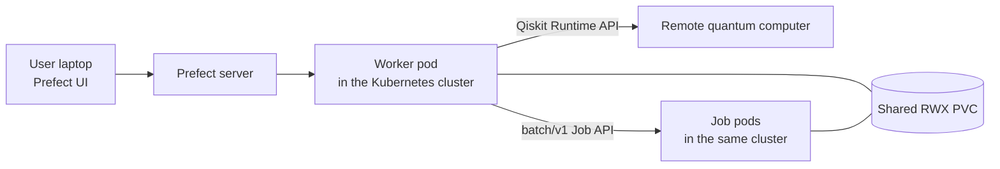
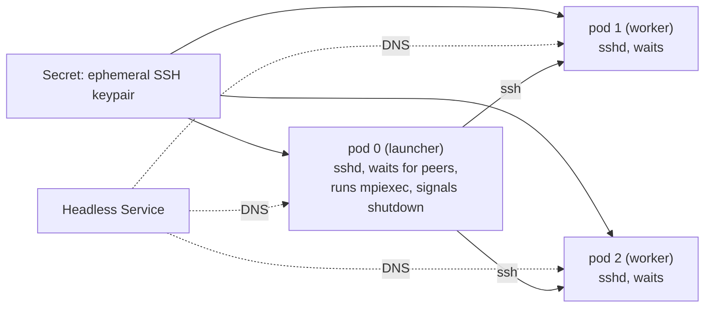

# Kubernetes Adapter Design

This document records the design of the Kubernetes adapter, the decisions made
while building it, and the options deliberately left for later. It is written
for contributors who need to extend the adapter, especially around data
transfer and multi-node execution.

## Status

| Area | Status |
|---|---|
| Single-pod `batch/v1` Job submission, wait, logs, cancel | Implemented |
| Cluster access (kubeconfig, context, in-cluster) | Implemented |
| Storage: passthrough volumes and shared-PVC shortcut | Implemented |
| `DataRef` seam with the `file://` scheme | Implemented |
| Multi-pod and MPI execution | Designed, not implemented |
| Gang scheduling | Designed, not implemented |
| Remote data transports (`ssh://`, `s3://`, `qiskit-job://`) | Not implemented, interface prepared |
| Prefect Block integration (`hpc_target="kubernetes"`) | Implemented |
| Testing against a real cluster | Not done (tests use fake API clients) |

## Goals and non-goals

**Goals**

- Run a command as a Kubernetes Job from a Prefect flow, on any conformant
  cluster (EKS, GKE, AKS, OpenShift, k3s, kind, and similar).
- Follow the structure of the existing Slurm, Miyabi, Fugaku and local adapters
  so that flows can treat Kubernetes as another execution target.
- Keep cluster-specific behavior out of the default path.

**Non-goals**

- Moving data between the Kubernetes cluster and other HPC clusters. The
  Kubernetes cluster runs in parallel with the HPC clusters. The workflows it
  enables exchange data with the quantum computer only.
- Depending on CRDs or add-ons (Kueue, Volcano, Kubeflow MPI Operator,
  JobSet) in the default path.

## Where the code runs

A Prefect worker (or a process started with `flow.serve(...)`) polls the
Prefect server and executes the flow's Python code, including every task. The
Prefect server stores state, logs and artifacts. It does not run user code or
submit jobs.

This means job submission is done by the flow process itself:

- Quantum submission is a Qiskit Runtime API call made by the flow process.
- Slurm, PBS and PJM submission is a command run by the flow process.
- Kubernetes submission is a Kubernetes API call made by the flow process.

**Decision:** the supported deployment is a worker pod inside the cluster. The
laptop is only a UI. A worker outside the cluster also works at the API level
(use a kubeconfig), but it cannot share a PVC with the job pods, so the
file-based data flow in this document does not apply to it.

### Flow runs as a batch Job

A flow that fans out to compute Jobs always runs in a pod in the cluster. An
interactive session runs it from a shell in the runner (or GUI) pod. A
non-interactive run is launched as a `batch/v1` Job by
`qcsc_prefect_executor.kubernetes.flow_launcher`, which renders
`runs/<run-id>/flow-job.yaml` and either applies it or leaves it for the user,
after a prompt. The flow command is arbitrary, so the pattern applies to any
flow whose main process controls work in other pods.

Decisions:

- **No work pool or deployment.** The flow starts with Prefect credentials from
  a Secret (`envFrom`) and is expected to appear in the Prefect UI as an ad hoc
  run. The expected trade-off is that a run cannot be cancelled from the Prefect
  UI, because nothing in the cluster listens for the cancellation. The user
  stops a run with `kubectl delete -f runs/<run-id>/`. A Kubernetes work pool
  would add UI cancellation, schedules and retries at the cost of a worker, a
  pool and a job template. Neither the UI behavior nor the state a deleted run
  is left in has been verified on a real cluster yet.
- **Cleanup by ownership, with a label as escape hatch.** Compute Jobs are
  created at run time, so their names cannot be in the run folder. The flow pod
  receives its own name and UID through the downward API
  (`QCSC_OWNER_POD_NAME`, `QCSC_OWNER_POD_UID`), and `run_job_from_blocks` sets
  an `ownerReference` to it on every compute Job. Deleting the flow Job then
  garbage-collects them, even when the flow process never ran its own cleanup.
  `blockOwnerDeletion` is not set, because it needs extra RBAC on clusters that
  enforce `OwnerReferencesPermissionEnforcement`. Every Job of the run also
  carries `qcsc-prefect/flow-run=<run-id>`, for
  `kubectl delete jobs -l qcsc-prefect/flow-run=<run-id>` if garbage collection
  misses something.
- **No retry.** The flow Job uses `backoffLimit: 0`, because a retry would run
  the flow again and submit the compute Jobs a second time.
- **Shared resources stay outside the run folder.** The Secret, service account,
  Role and PVC are reused by every run.

Known limits: the flow pod needs permission to create Jobs, so whoever can
launch a flow inherits it. The flow's code and virtual environment are taken
from the shared volume, so syncing them is the user's job. Flows that need an
interactive site login (an SSH one-time password, or an allow-listed source
address) or per-iteration pod start-up in a tight loop do not fit this pattern.

## Components

The adapter follows the layering used by the other targets.

| Layer | Module | Responsibility |
|---|---|---|
| Core | `qcsc_prefect_core.data_ref` | `DataRef` and resolvers (scheme-independent) |
| Adapter, builder | `qcsc_prefect_adapters.kubernetes.builder` | `KubernetesJobRequest`, `build_job_manifest` |
| Adapter, runtime | `qcsc_prefect_adapters.kubernetes.runtime` | `KubernetesConnection`, `KubernetesRuntime` |
| Executor | `qcsc_prefect_executor.kubernetes.run` | `run_kubernetes_job` |

### Builder

`build_job_manifest(exec_profile=..., req=...)` returns a plain `batch/v1` Job
dictionary. It uses only core Job and Pod fields.

- The profile's `walltime` becomes `activeDeadlineSeconds`.
- `backoffLimit` defaults to 0 so a failure is reported once.
- `ttlSecondsAfterFinished` defaults to 3600 for automatic cleanup.
- CPU, memory and `extra_resources` (for example `nvidia.com/gpu`) are set as
  both requests and limits.
- Anything cluster-specific goes through `pod_spec_overrides`
  (`runtimeClassName`, `securityContext`, and so on) or through
  `node_selector` and `tolerations`.
- Job names are sanitized to DNS-1123 labels and capped at 52 characters. A
  unique name is generated when none is given.

`modules` and `pre_commands` in the execution profile are rejected, because
there is no login shell to apply them. Setup belongs in the container image.
`num_nodes != 1` is rejected for the same reason that multi-node support is not
yet implemented (see [Multi-node execution](#multi-node-execution-designed-not-implemented)).

### Runtime

`KubernetesRuntime` wraps the Kubernetes API with `kubernetes_asyncio`, so it
fits Prefect's async execution model. The dependency is optional:
`pip install 'qcsc-prefect-adapters[kubernetes]'`.

- Job ids have the form `<namespace>/<name>`.
- `wait_final_status` polls the Job conditions and returns a status dictionary
  shaped like the Slurm one (`State`, `ExitCode`, and so on). The exit code
  comes from the terminated container of the most recent pod.
- On timeout or Prefect cancellation, the Job is deleted so nothing leaks.
- `cancel` treats "not found" as success and raises `CancelError` otherwise.

`KubernetesConnection` selects how to reach the cluster, in this order:

1. An explicit `kubeconfig_path` or `context`.
2. In-cluster service-account configuration, used automatically when
   `KUBERNETES_SERVICE_HOST` is set. `in_cluster=True/False` forces the choice.
3. The default kubeconfig (`$KUBECONFIG` or `~/.kube/config`).

### Executor

`run_kubernetes_job` builds the manifest, saves it to
`<work_dir>/job-manifest.json` for debugging, submits, waits, fetches logs,
publishes a Prefect table artifact and returns a `KubernetesRunResult`.
Log retrieval is best-effort: a failure to read logs is a warning, because the
Job result is authoritative.

### Working directory check

When `work_volume_claim` is set, `build_job_manifest` rejects a `working_dir`
that is not inside `work_mount_path`. The pod mounts the volume only at that
path, so the directory would not exist there, and the Job would fail at
container start instead of at submission.

### Required RBAC

The service account used by the worker needs these permissions in the target
namespace:

| Resource | Verbs |
|---|---|
| `jobs` (`batch`) | `create`, `get`, `delete` |
| `jobs/status` (`batch`) | `get` |
| `pods` | `list` |
| `pods/log` | `get` |

The multi-node design below adds `secrets` and `services`.

## Storage

The job pods and the worker need to see the same files. The decision follows
how the existing HPC targets already work: **make the path identical on both
sides.** On Slurm the flow runs on the login node, or mounts the cluster
filesystem with `sshfs` (see [File Sync](../howto/howto_setup_file_sync.md)).
On Kubernetes the equivalent is a shared ReadWriteMany PVC mounted at the same
path in the worker pod and in every job pod.

| Option | Provided by | Notes |
|---|---|---|
| Existing RWX PVC | `work_volume_claim` and `work_mount_path` | Primary path. Also sets the container working directory. |
| Any other volume | `volumes` and `volume_mounts` | Raw Kubernetes dictionaries. NFS, CSI, `hostPath`, ConfigMap, Secret and so on. |
| Dynamic PVC from a StorageClass | Not provided | Persistence depends on the class's reclaim policy, so lifecycle needs a deliberate design. |
| Generic ephemeral volume or `emptyDir` | Via `volumes` | Per-pod scratch only. |

Delivering the solver executable has three routes: build an image that
contains it, place it on the shared volume and run it from there, or copy it
from a solver-only image with an init container. The first two work today.

!!! note "Volume names"
    The shortcut volume is named `qcsc-work`. Do not use that name for a
    passthrough volume.

## Data transfer

### What the code does today

In the bitcount demo, data moves through the flow process:

1. The quantum result comes back to the flow process as an in-memory list
   (`sample_bitstrings` returns `results[0].data.meas.get_bitstrings()`).
2. The flow writes `input.bin` to a per-job `work_dir`.
3. The job reads `input.bin` and writes `output.json` in the same directory.
4. The flow reads `output.json` back.

No demo stages data between remote systems. The only data shared across
machines is a path that is identical on both sides by construction.
Prefect-level result persistence (compressed pickle keyed by Qiskit job id)
caches task results but is not a data-movement layer.

### Conclusion

**Do not build a generic transfer system now, but make sure that adding one
later does not require redesigning flows.**

Reasons:

- Current devices have a limited qubit count, so result volume is modest. Even
  large shot counts accumulate over a long time, so streaming results back
  through the flow process is acceptable.
- The Kubernetes cluster does not exchange data with the other HPC clusters,
  so no cluster-to-cluster transfer is needed.
- IBM Quantum Runtime does not provide a bucket on the quantum side. Results
  are fetched by job id through the API. A future "stage at the quantum end"
  is therefore a fetch by job id from a process with network access, which can
  be the job pod itself. It is not a copy between two storage systems.
- A generic transport layer needs credentials per endpoint, integrity checks
  and cleanup. Building it without a concrete use case would guess at all
  three.

### The seam: `DataRef`

The change that keeps the future open is to **pass references between tasks
instead of the data itself.**

`DataRef` (in `qcsc_prefect_core.data_ref`) is a frozen, serializable value:

| Field | Meaning |
|---|---|
| `uri` | Location, for example `file:///data/work/job1/input.bin` |
| `size` | Optional size in bytes |
| `sha256` | Optional hex digest |
| `metadata` | Free-form string metadata |

A resolver handles one URI scheme and provides `exists`, `open`,
`materialize(ref, dest)` and `verify`. Resolvers are looked up by scheme with
`get_resolver` and added with `register_resolver`. Only `file://` is
implemented (`FileResolver`).

`run_kubernetes_job` uses the seam:

- `inputs` are verified before anything is submitted (existence, size and
  checksum). A missing or corrupt input fails before the cluster is touched.
- `expected_outputs` become `DataRef` values in `KubernetesRunResult.outputs`,
  only after a successful run. A declared output that does not exist raises
  `FileNotFoundError`, so a Job that exits 0 without producing its output
  cannot go unnoticed.

Because consumers hold a `DataRef` and not a path, a later scheme replaces the
storage behind it without changing flows.

!!! warning "Same-path assumption"
    `file://` references assume the worker and the job pods mount the PVC at
    the same path. A mismatch is only detectable on a real cluster.

### Future additions

None of the following is implemented. They are recorded so that the next
contributor starts from the conclusions reached here.

#### Questions to answer first

Collect these facts before choosing a design:

1. How large is the data, and which hop is the bottleneck: quantum to
   cluster, or cluster to worker?
2. Who performs the transfer: the flow process, the job pod, or a dedicated
   transfer Job?
3. Is the transfer initiated by the producer (push) or by the consumer
   (pull)?
4. How are credentials supplied and rotated?
5. Where are integrity checks and cleanup performed?

#### Transport candidates

| Scheme | Use case | Notes |
|---|---|---|
| `qiskit-job://<job-id>` | Quantum results too large to stream through the flow process | The job pod fetches the result by id and writes it to the shared volume. Preferred for the quantum-to-cluster hop. |
| `s3://`, `gs://` | Object-storage staging | Needs credentials and a client dependency. |
| `ssh://user@host/path` | Moving files to or from a host reachable over SSH | See below. |

#### Design sketch for an SSH transport

If a transport over SSH is ever needed (for example for a host that offers
only SSH), it should be a **pull from inside the cluster**, expressed as
another Kubernetes Job:

- A Job mounts the shared PVC and runs `rsync` or `scp` against the remote
  host. This needs no new runtime code, because `run_kubernetes_job` already
  runs Jobs.
- A transport should return a **plan** (a `KubernetesJobRequest`) instead of
  performing the transfer inside `materialize`. That keeps resolvers free of
  any dependency on the Kubernetes runtime and keeps `file://` a no-op.
- Pull works on any cluster because it needs only outbound connectivity. A
  push model requires exposing an `sshd` pod through a NodePort, load balancer
  or TCP ingress, which differs per cluster and creates a long-lived attack
  surface.

Problems to solve before implementing it:

1. **Unattended authentication.** The Miyabi setup uses SSH keys plus a
   one-time password, which a Job cannot supply. A dedicated key or a
   service account approved by the site is required, and some sites forbid
   unattended keys.
2. **Host key verification.** Pin `known_hosts`. Never use
   `StrictHostKeyChecking=no`.
3. **Secrets.** Store the private key in a Kubernetes Secret, mount it
   read-only, and make the Job own it for cleanup.
4. **Integrity and atomicity.** Write to a temporary name, use `--partial`,
   verify the checksum from the `DataRef`, then rename.
5. **Reachability.** Some login nodes accept connections only from allow-listed
   addresses. The cluster's egress address may be shared or may change.
6. **Throughput.** A single SSH stream is fine for modest volumes and is not a
   high-speed transfer service.

!!! note
    SSH does not apply to IBM Quantum Runtime, which has no SSH endpoint.

## Multi-node execution (designed, not implemented)

`num_nodes != 1` and the `mpirun`-style launchers across pods are rejected
today. The rationale and the intended design are recorded here.

### Why not a plain `parallelism=N` Job

On an HPC scheduler, `num_nodes=4` is a single allocation that starts together
and lets `srun` or `mpirun` reach every node. A plain Job with
`parallelism=4` gives neither. Pods start independently, are not wired
together, and can be scheduled at different times.

### Why not a StatefulSet or Deployment

A StatefulSet and a Deployment require `restartPolicy: Always`. A process that
exits with code 0 is restarted, and the controller never reports completion.
Completion detection, exit-code capture, retries, deadlines and cleanup would
all have to be rebuilt. A Job already provides them (`Complete`/`Failed`
conditions, `backoffLimit`, `activeDeadlineSeconds`,
`ttlSecondsAfterFinished`). An **Indexed Job** (`completionMode: Indexed`)
combined with a headless Service gives the one thing a StatefulSet would add,
stable per-pod DNS names, while keeping Job semantics.

### Design

One Indexed Job, a headless Service and a per-job Secret. Pod index 0 is the
launcher and the others are workers.

- **Pod names and DNS.** The pod template sets `subdomain` to the Service name.
  Pods get hostnames `<job>-<index>` and DNS names
  `<job>-<index>.<service>.<namespace>.svc`. The Service is headless with
  `publishNotReadyAddresses: true`, so peers resolve before they are Ready.
- **Service selector.** Select on an own label such as `qcsc-prefect/job:
  <job>`, not on a Kubernetes-version-dependent Job label. The Service does not
  need the Job to exist first, because it selects pods by label.
- **Entrypoint.** Every pod runs the same entrypoint and branches on
  `JOB_COMPLETION_INDEX`. Workers start `sshd` and wait. The launcher builds a
  hostfile, waits for every peer's SSH port with a timeout, runs the launcher
  command, tells the workers to stop, and exits with the launcher's exit code.
  The workers' shutdown is required, because a worker sitting in `sshd` would
  keep the Job from ever completing.
- **Keys.** The client generates a fresh keypair per job and stores it in a
  Secret, used as user key and host key, with `authorized_keys` accepting only
  that key.
- **Cleanup order.** Create the Secret first (pods mount it at startup), create
  the Job and read its UID, then create the Service and patch ownerReferences
  on the Secret and Service so the Job's TTL cleanup removes all three. If Job
  creation fails, delete the Secret explicitly.

### Base image

A published base image, which users extend with `FROM`, contains:

- an MPI implementation,
- `openssh-server` and `rsync`,
- the entrypoint described above.

**MPI choice.** The demo sources use only the standard MPI C API. The HPC
targets use Intel MPI with `mpiexec.hydra` on Miyabi and Fujitsu MPI with
`mpiexec` on Fugaku. Intel MPI uses the Hydra process manager, as MPICH does,
and is ABI-compatible with it. The default is therefore **MPICH**, so existing
execution profiles carry over with little change. An OpenMPI variant can be
added later because `mpi_options` is passed straight through.

**Root.** The decision is to assume that pods may run as root. `sshd` then runs
on port 22 as the real user, avoiding the high port, `nss_wrapper` and
`UsePAM` workarounds that arbitrary-UID environments such as OpenShift
require. Non-root operation is out of scope for the first version.

### Gang scheduling

Stable DNS does not make pods start together. Without gang scheduling, a
subset of pods can run and hold resources while the rest stay `Pending`.
Core Kubernetes does not prevent this. The launcher's peer-wait timeout turns
the stuck state into a clean failure but does not give all-or-nothing
admission.

Gang scheduling stays pluggable, and the default path adds nothing
cluster-specific:

| Option | How a Job opts in | Requires |
|---|---|---|
| Kueue | Label `kueue.x-k8s.io/queue-name` and create the Job with `suspend: true` | Kueue controller |
| Volcano | `schedulerName: volcano` and a PodGroup annotation | Volcano scheduler |
| scheduler-plugins coscheduling | PodGroup and pod label | Custom scheduler |
| None | Optional init-container barrier that waits for peers | Nothing; deadlock-prone under contention |

A `gang_scheduler` option would only add labels, annotations,
`schedulerName` and `suspend`. The code never talks to the add-on APIs, so a
missing add-on cannot break the default path.

### Other constraints

- **RBAC grows.** The worker's service account also needs create and delete on
  `secrets` and `services`.
- **Networking.** NetworkPolicies must allow pod-to-pod traffic inside the Job.
  Traffic is TCP only. InfiniBand or RDMA needs extra device plugins and MPI
  configuration, so expect Ethernet-class performance.
- **Image maintenance.** The base image needs a registry, amd64 and arm64
  builds, and variants for other MPI versions or CUDA.
- **Kubernetes version.** Indexed Jobs require 1.24 or later.
  `successPolicy` and per-index backoff need newer releases (1.33), so the
  design uses the launcher's shutdown signal instead.

## Open items

1. Implement multi-node execution (the Indexed Job, Service, Secret, base
   image and entrypoint above), and test it on a kind cluster with a two-pod
   `mpiexec hostname` check.
2. Add `kubernetes` to `HPCProfileBlock.hpc_target` and integrate it with
   `run_job_from_blocks`, so flows can select Kubernetes by profile name.
3. Move the bitcount demo from passing lists to passing `DataRef` values.
4. Validate the whole path on a real cluster with an RWX storage class.
5. When the first remote data need appears, collect the facts listed under
   [Questions to answer first](#questions-to-answer-first) and add a resolver
   for it.

## Decision log

| Decision | Choice | Alternative considered |
|---|---|---|
| Resource type | `batch/v1` Job | Deployment, StatefulSet, bare Pod |
| Pods per Job | One (first version) | Indexed Job with `parallelism=N` |
| Worker location | Inside the cluster | Outside, with a kubeconfig |
| Client library | `kubernetes_asyncio` (optional extra) | The synchronous `kubernetes` client |
| Shared storage | Same path on both sides via an RWX PVC | Staging through object storage |
| Data transfer | `DataRef` seam with `file://` only | Generic transfer system now |
| First remote transport | Not chosen | `qiskit-job://`, `s3://`, `ssh://` |
| MPI implementation (future image) | MPICH | OpenMPI, Intel MPI |
| User for MPI pods | Root | Arbitrary non-root UID |
| Multi-node pod naming | Indexed Job and headless Service | StatefulSet and headless Service |
| Gang scheduling | Pluggable, off by default | Hard dependency on one scheduler |
