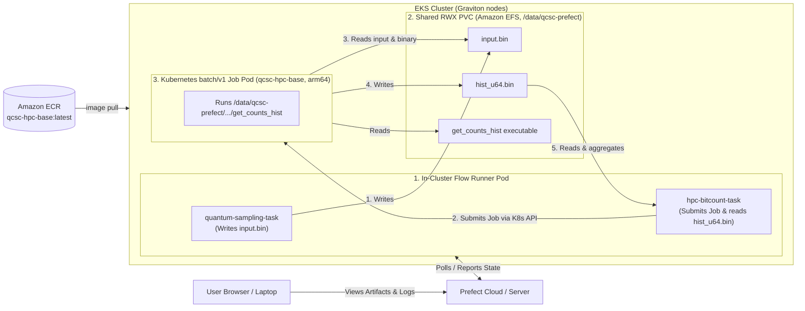

# Create Your QCSC Workflow with Prefect on AWS EKS (Graviton)

This hands-on tutorial runs the BitCount demo on an existing **Amazon EKS** cluster whose worker nodes use **AWS Graviton (arm64)** processors.
It follows the same flow as [Create Your QCSC Workflow with Prefect for Kubernetes](create_qcsc_workflow_for_kubernetes.md), with these EKS-specific changes:

- The container image is built for `linux/arm64` and pushed to **Amazon ECR**.
- The shared ReadWriteMany (RWX) volume is **Amazon EFS**, mounted through the EFS CSI driver. The `kind` tutorial's `hostPath` volume cannot be shared across nodes.
- Pods are pinned to arm64 nodes.

Both the Prefect flow process and the compute Job pods run inside the cluster and mount the same PVC.

---

## Architecture & Data Flow



Because the runner pod and the Job pods may be scheduled on different nodes (and different Availability Zones), the shared volume must be a network file system. EFS fills that role.

> [!IMPORTANT]
> The compiled `get_counts_hist` binary and the Python virtual environment are built on arm64 and stored on the shared volume.
> Every pod that uses them must run on an arm64 node. Mixing x86_64 and arm64 nodes in the same cluster will cause `exec format error`.

---

## What you need

- An existing EKS cluster with at least one **Graviton** managed node group (for example `m7g`, `c7g`, `t4g`) and `kubectl` access to it
- AWS CLI v2 configured with permissions to use ECR and EFS (and EC2 security groups)
- `eksctl` (used below to create the IAM role for the EFS CSI driver; you can use the console or CloudFormation instead)
- Docker or Podman. If you build on an Apple Silicon Mac, the image is native arm64. On an x86_64 machine, enable QEMU emulation, or build on a Graviton EC2 instance or in CI.
- A reachable Prefect backend (Prefect Cloud account or self-hosted Prefect server). The nodes need outbound internet access to it (private subnets need a NAT gateway).

If you want to run against IBM Quantum Runtime later, you will also need:
- A configured `QuantumRuntime` block such as `ibm-runner`
- IBM Quantum credentials set up in Prefect

Set these shell variables once; later commands reuse them:

```bash
export AWS_REGION=<region>              # e.g. us-east-1
export CLUSTER_NAME=<eks-cluster-name>
export ACCOUNT_ID=$(aws sts get-caller-identity --query Account --output text)
export ECR_HOST=$ACCOUNT_ID.dkr.ecr.$AWS_REGION.amazonaws.com
export IMG=$ECR_HOST/qcsc-hpc-base:latest
```

---

## Step 0. Connect to the EKS Cluster and Verify Graviton Nodes

```bash
aws eks update-kubeconfig --name "$CLUSTER_NAME" --region "$AWS_REGION"
kubectl get nodes -L kubernetes.io/arch,node.kubernetes.io/instance-type
```

The `ARCH` column should show `arm64` for the nodes that will run the workflow.

---

## Step 1. Build the Generic HPC Base Image for arm64 and Push to ECR

1. **Create the ECR repository** (one time):

```bash
aws ecr create-repository --repository-name qcsc-hpc-base --region "$AWS_REGION"
```

2. **Log in to ECR**:

```bash
aws ecr get-login-password --region "$AWS_REGION" \
  | docker login --username AWS --password-stdin "$ECR_HOST"
```

3. **Build the image for `linux/arm64`**. [`docker/build_hpc_base.sh`](../../docker/build_hpc_base.sh) passes no platform flag, but `docker build` honors `DOCKER_DEFAULT_PLATFORM`:

```bash
DOCKER_DEFAULT_PLATFORM=linux/arm64 ./docker/build_hpc_base.sh "$IMG"
```

Equivalent explicit command:

```bash
docker build --platform linux/arm64 -t "$IMG" -f docker/Dockerfile.hpc-base .
```

> [!NOTE]
> The `ubuntu:24.04` base image and the apt packages in `Dockerfile.hpc-base` (Open MPI, GCC, Python) all have arm64 builds, so no Dockerfile changes are needed.

4. **Push the image**:

```bash
docker push "$IMG"
```

5. **Verify the architecture** of what you pushed:

```bash
aws ecr describe-images --repository-name qcsc-hpc-base --region "$AWS_REGION"
docker image inspect "$IMG" --format '{{.Architecture}}'   # expect: arm64
```

EKS worker nodes normally pull from ECR through the node IAM role (`AmazonEC2ContainerRegistryReadOnly` or equivalent), so no image pull secret is required. If your nodes use a custom role, confirm it has ECR read permissions.

---

## Step 2. Create Shared RWX Storage with Amazon EFS

### 2.1 Create the file system and mount targets

Find the cluster's VPC, subnets, and node security group:

```bash
VPC_ID=$(aws eks describe-cluster --name "$CLUSTER_NAME" --region "$AWS_REGION" \
  --query 'cluster.resourcesVpcConfig.vpcId' --output text)
aws eks describe-cluster --name "$CLUSTER_NAME" --region "$AWS_REGION" \
  --query 'cluster.resourcesVpcConfig.{subnets:subnetIds,clusterSG:clusterSecurityGroupId}'
```

Create a security group that allows NFS (TCP 2049) from the cluster's node security group:

```bash
NODE_SG=<cluster-or-node-security-group-id>

EFS_SG=$(aws ec2 create-security-group --group-name qcsc-efs-sg \
  --description "NFS access to QCSC EFS" --vpc-id "$VPC_ID" \
  --region "$AWS_REGION" --query GroupId --output text)

aws ec2 authorize-security-group-ingress --group-id "$EFS_SG" \
  --protocol tcp --port 2049 --source-group "$NODE_SG" --region "$AWS_REGION"
```

Create the file system and one mount target in **each subnet that hosts your nodes**:

```bash
FS_ID=$(aws efs create-file-system --region "$AWS_REGION" \
  --performance-mode generalPurpose --throughput-mode elastic --encrypted \
  --tags Key=Name,Value=qcsc-shared-storage \
  --query FileSystemId --output text)

# Repeat for every node subnet (wait until the file system is "available" first)
aws efs create-mount-target --file-system-id "$FS_ID" \
  --subnet-id <subnet-id> --security-groups "$EFS_SG" --region "$AWS_REGION"
```

Check mount target status:

```bash
aws efs describe-mount-targets --file-system-id "$FS_ID" --region "$AWS_REGION" \
  --query 'MountTargets[].{subnet:SubnetId,state:LifeCycleState}'
```

### 2.2 Install the EFS CSI driver

Create the IAM role for the driver's controller service account:

```bash
eksctl create iamserviceaccount \
  --cluster "$CLUSTER_NAME" --region "$AWS_REGION" \
  --namespace kube-system --name efs-csi-controller-sa \
  --attach-policy-arn arn:aws:iam::aws:policy/service-role/AmazonEFSCSIDriverPolicy \
  --role-only --role-name AmazonEKS_EFS_CSI_DriverRole --approve
```

Install the EKS add-on:

```bash
aws eks create-addon --cluster-name "$CLUSTER_NAME" --region "$AWS_REGION" \
  --addon-name aws-efs-csi-driver \
  --service-account-role-arn arn:aws:iam::$ACCOUNT_ID:role/AmazonEKS_EFS_CSI_DriverRole
```

Verify the driver pods are running (an `efs-csi-node` pod should exist on each node, including the Graviton nodes):

```bash
kubectl get pods -n kube-system -l app.kubernetes.io/name=aws-efs-csi-driver -o wide
```

> [!TIP]
> If your cluster uses EKS Pod Identity instead of IRSA, associate the same `AmazonEFSCSIDriverPolicy` role with the `efs-csi-controller-sa` service account using a Pod Identity association instead of `eksctl create iamserviceaccount`.

---

## Step 3. Deploy Cluster Infrastructure (PV, PVC, RBAC, Runner Pod)

Create `k8s-qcsc-setup-eks.yaml`. Replace `<FS_ID>` with your EFS file system ID (`echo $FS_ID`) and `<ECR_IMAGE>` with the value of `$IMG`.

```yaml
apiVersion: v1
kind: PersistentVolume
metadata:
  name: qcsc-pv
spec:
  capacity:
    storage: 10Gi            # Required by Kubernetes; EFS does not enforce it
  accessModes:
    - ReadWriteMany
  persistentVolumeReclaimPolicy: Retain
  storageClassName: efs-static
  csi:
    driver: efs.csi.aws.com
    volumeHandle: <FS_ID>    # e.g. fs-0123456789abcdef0
---
apiVersion: v1
kind: PersistentVolumeClaim
metadata:
  name: qcsc-shared-pvc
  namespace: default
spec:
  accessModes:
    - ReadWriteMany
  storageClassName: efs-static
  volumeName: qcsc-pv
  resources:
    requests:
      storage: 10Gi
---
apiVersion: v1
kind: ServiceAccount
metadata:
  name: qcsc-prefect-runner
  namespace: default
---
apiVersion: rbac.authorization.k8s.io/v1
kind: Role
metadata:
  name: qcsc-job-manager
  namespace: default
rules:
- apiGroups: ["batch"]
  resources: ["jobs", "jobs/status"]
  verbs: ["get", "list", "watch", "create", "delete"]
- apiGroups: [""]
  resources: ["pods", "pods/log", "pods/status"]
  verbs: ["get", "list", "watch"]
---
apiVersion: rbac.authorization.k8s.io/v1
kind: RoleBinding
metadata:
  name: qcsc-job-manager-binding
  namespace: default
subjects:
- kind: ServiceAccount
  name: qcsc-prefect-runner
  namespace: default
roleRef:
  kind: Role
  name: qcsc-job-manager
  apiGroup: rbac.authorization.k8s.io
---
apiVersion: v1
kind: Pod
metadata:
  name: qcsc-prefect-runner
  namespace: default
spec:
  serviceAccountName: qcsc-prefect-runner
  nodeSelector:
    kubernetes.io/arch: arm64
  containers:
  - name: runner
    image: <ECR_IMAGE>       # e.g. 123456789012.dkr.ecr.us-east-1.amazonaws.com/qcsc-hpc-base:latest
    imagePullPolicy: Always
    command: ["/bin/bash", "-c", "sleep infinity"]
    volumeMounts:
    - name: shared-storage
      mountPath: /data/qcsc-prefect
  volumes:
  - name: shared-storage
    persistentVolumeClaim:
      claimName: qcsc-shared-pvc
```

Apply it and verify:

```bash
kubectl apply -f k8s-qcsc-setup-eks.yaml
kubectl get pv,pvc
kubectl get pod qcsc-prefect-runner -o wide
```

The PVC should be `Bound` and the pod `Running` on an arm64 node.

> [!NOTE]
> Unlike the `kind` tutorial, this manifest uses `imagePullPolicy: Always` because the image comes from ECR rather than being pre-loaded onto the node. Use an immutable tag (for example a git SHA) instead of `latest` if you want reproducible runs.

---

## Step 4. Connect to the In-Cluster Runner Pod

```bash
kubectl exec -it qcsc-prefect-runner -- bash
```

Inside the pod:

```bash
cd /data/qcsc-prefect
git clone https://github.com/qiskit-community/qcsc-prefect.git .

python3 -m venv .venv
source .venv/bin/activate

pip install -e packages/qcsc-prefect-core \
            -e "packages/qcsc-prefect-adapters[kubernetes]" \
            -e packages/qcsc-prefect-blocks \
            -e packages/qcsc-prefect-executor \
            -e packages/qcsc-prefect-qiskit \
            prefect-qiskit
```

> [!NOTE]
> The `._*` AppleDouble cleanup from the `kind` tutorial is not needed here, because the repository is cloned directly on Linux.

---

## Step 5. Build the BitCount Executable (on arm64)

Still inside the runner pod, compile directly onto the shared volume. Because the runner pod is an arm64 pod, the binary is arm64, which matches the Job pods:

```bash
mkdir -p /data/qcsc-prefect/examples/prefect_bitcount_demo/bin

mpicxx -O3 -std=c++17 \
  -o /data/qcsc-prefect/examples/prefect_bitcount_demo/bin/get_counts_hist \
  examples/prefect_bitcount_demo/src/get_counts_hist.cpp

file /data/qcsc-prefect/examples/prefect_bitcount_demo/bin/get_counts_hist   # expect: ARM aarch64
```

---

## Step 6. Log in to Prefect and Create Blocks

```bash
prefect cloud login --key "<PREFECT_API_KEY>"
```

Register the Kubernetes blocks and variables. Replace the image with your ECR URI. Use `IfNotPresent` or `Always` for the pull policy as appropriate (the tutorial default is `IfNotPresent`):

```bash
python examples/prefect_bitcount_demo/create_blocks.py \
  --hpc-target kubernetes \
  --kubernetes-image <ACCOUNT_ID>.dkr.ecr.<region>.amazonaws.com/qcsc-hpc-base:latest \
  --kubernetes-namespace default \
  --kubernetes-work-volume-claim qcsc-shared-pvc \
  --kubernetes-work-mount-path /data/qcsc-prefect \
  --work-dir /data/qcsc-prefect/work/bitcount_k8s \
  --optimized-executable /data/qcsc-prefect/examples/prefect_bitcount_demo/bin/get_counts_hist
```

If `latest` is cached on the nodes and you push a new image, pass `--kubernetes-image-pull-policy Always`.

> [!IMPORTANT]
> Three settings must agree with where the runner pod mounts the PVC (`/data/qcsc-prefect` in this tutorial's manifest): `--kubernetes-work-mount-path`, `--work-dir`, and `--optimized-executable`. If you mount the PVC somewhere else (for example `/ldata`), change all three to match. The runner and the Job pods must see the work directory at the same path.

### SELinux-enforcing nodes (EKS Auto Mode): launch through `mpirun`

EKS Auto Mode nodes run SELinux in enforcing mode. A Job pod can fail immediately with:

```text
exec /<mount-path>/.../bin/get_counts_hist: permission denied
```

even though the file is `rwxr-xr-x` and runs fine when you start it from a shell inside a pod.

**Cause.** The binary lives on the shared volume, and files on many network and parallel file systems carry a generic SELinux label such as `local_t` instead of the container label that files from the image have. The node's audit log shows the denial:

```text
avc: denied { entrypoint } comm="runc:[2:INIT]" path=".../bin/get_counts_hist"
  scontext=system_u:system_r:container_t:s0:c201,c524
  tcontext=system_u:object_r:local_t:s0 tclass=file permissive=0
```

`container_t` is not allowed the `entrypoint` permission on a `local_t` file. The container runtime needs that permission only when the file is the container's **first process**. Running the same file from a shell already inside the container needs ordinary execute permission, so it works. The exact label depends on your storage driver; the shared-volume type in the example above is whatever your cluster's PV/PVC uses.

**Workaround.** Make `mpirun` from the image the container's first process, so it starts `get_counts_hist` as a child:

```bash
BITCOUNT_MPI_OPTIONS="-np,1" python examples/prefect_bitcount_demo/create_blocks.py \
  --hpc-target kubernetes --launcher mpirun \
  ... # same flags as above
```

- `-np 1` keeps a single MPI rank, matching the default `single` launcher. The option is passed through the environment variable because argparse would read a value starting with `-` as a flag.
- Skip this if your Job pods start normally.
- Baking `get_counts_hist` into the container image also avoids the problem, because the binary then carries the container's own label.
- Relabeling the volume (for example with a `context=` mount option) might also work. It has not been tried here, and whether it is allowed depends on your storage driver and the Auto Mode SELinux policy.
- Setting the same `seLinuxOptions.level` (MCS categories) on all pods is the approach [AWS documents for sharing volumes between pods](https://docs.aws.amazon.com/eks/latest/userguide/auto-troubleshoot.html). It addresses category isolation, not the type denial above, and has not been tried for this problem.

### Registered Blocks & Variables

| Block / Variable | Name | Purpose |
|---|---|---|
| `CommandBlock` | `cmd-bitcount-hist` | Command definition (`executable_key=bitcount_hist`) |
| `ExecutionProfileBlock` | `exec-bitcount-k8s` | Pod launcher configuration and CPU/memory limits |
| `HPCProfileBlock` | `hpc-k8s-bitcount` | Kubernetes execution target, container image, and shared PVC |
| `Variable` | `k8s-bitcount-options` | Sampler options and base working directory |

### Placing Job pods on specific nodes (node selector and tolerations)

The Job pods run the arm64 image and the arm64 binary, so they must land on Graviton nodes.
If your Graviton nodes carry labels and taints (for example an EKS Auto Mode custom NodePool), pass matching values to `create_blocks.py`. They are stored on the `HPCProfileBlock` and applied to every Job pod:

```bash
python examples/prefect_bitcount_demo/create_blocks.py \
  ... \
  --kubernetes-node-selector use=infra kubernetes.io/arch=arm64 \
  --kubernetes-toleration use=infra:NoSchedule arch=arm64:NoSchedule
```

- `--kubernetes-node-selector` takes `KEY=VALUE` pairs; every label must match the node.
- `--kubernetes-toleration` takes `KEY=VALUE:EFFECT` (operator `Equal`), or `KEY:EFFECT` / `KEY` (operator `Exists`). Copy the key, value, and effect from the NodePool's `taints`.
- The same settings can be given in a `--config` TOML file (`kubernetes_node_selector = { use = "infra" }`, `kubernetes_tolerations = ["use=infra:NoSchedule"]`; see [`bitcount_blocks.example.toml`](../../examples/prefect_bitcount_demo/bitcount_blocks.example.toml)) or as the environment variables `BITCOUNT_KUBERNETES_NODE_SELECTOR` and `BITCOUNT_KUBERNETES_TOLERATIONS` (comma-separated).
- If you omit them, no node selector or tolerations are set. That is fine on a Graviton-only cluster with no taints.

> [!IMPORTANT]
> The runner pod in `k8s-qcsc-setup-eks.yaml` needs the same `nodeSelector` and `tolerations` in its pod spec. `create_blocks.py` only configures the Job pods.
>
> ```yaml
> spec:
>   nodeSelector:
>     use: infra
>     kubernetes.io/arch: arm64
>   tolerations:
>   - {key: use, operator: Equal, value: infra, effect: NoSchedule}
>   - {key: arch, operator: Equal, value: arm64, effect: NoSchedule}
> ```

---

## Step 7. Run the Optimized Flow

Deterministic random bitstrings:

```bash
python examples/prefect_bitcount_demo/flow_optimized.py \
  --quantum-source random \
  --command-block cmd-bitcount-hist \
  --execution-profile-block exec-bitcount-k8s \
  --hpc-profile-block hpc-k8s-bitcount \
  --options-variable k8s-bitcount-options \
  --work-dir /data/qcsc-prefect/work/bitcount_k8s
```

Or against IBM Quantum hardware:

```bash
python examples/prefect_bitcount_demo/flow_optimized.py \
  --quantum-source real-device \
  --runtime-block ibm-runner \
  --command-block cmd-bitcount-hist \
  --execution-profile-block exec-bitcount-k8s \
  --hpc-profile-block hpc-k8s-bitcount \
  --options-variable k8s-bitcount-options \
  --work-dir /data/qcsc-prefect/work/bitcount_k8s
```

In a second terminal you can watch the Job pod being created on a Graviton node:

```bash
kubectl get jobs,pods -o wide -w
```

---

## Step 8. Verify Results & Inspect Artifacts

When `flow_optimized.py` finishes, it returns a summary dictionary:

```text
{
  'mode': 'optimized',
  'job_id': 'default/prefect-bitcount-hist-...',
  'shots': 100000,
  'num_unique_bitstrings': 1024,
  'work_dir': '/data/qcsc-prefect/work/bitcount_k8s/job_...'
}
```

In the Prefect UI, open the completed flow run and inspect the **Artifacts**:
- **`bitcount-optimized-metrics`**: job ID, execution state (`COMPLETED`), exit code (`0`), duration, pod name, and node name.
- **`sampler-count-dict-optimized`**: the table of unique bitstrings and counts produced by the Kubernetes compute job.

The node name should be one of your Graviton nodes.

---

## Troubleshooting & Tips

### 1. Runner pod stuck in `ContainerCreating` (mount timeout)
- **Symptom**: `kubectl describe pod qcsc-prefect-runner` shows `MountVolume.SetUp failed ... mount.nfs4: Connection timed out`.
- **Causes and fixes**:
  - There is no EFS mount target in the AZ/subnet where the pod was scheduled. Add one.
  - The EFS security group does not allow TCP 2049 from the node security group.
  - The `efs-csi-node` pod is not running on that node. Check `kubectl get pods -n kube-system -l app.kubernetes.io/name=aws-efs-csi-driver -o wide`.

### 2. `exec format error`
- **Cause**: an x86_64 image or binary on an arm64 node, or the reverse.
- **Fix**: rebuild the image with `--platform linux/arm64` (Step 1), recompile `get_counts_hist` from inside the arm64 runner pod (Step 5), and ensure Job pods are only scheduled on arm64 nodes.

### 3. `ImagePullBackOff` or `no match for platform in manifest`
- **Cause**: the image was pushed without an arm64 variant, or the node role lacks ECR read permissions.
- **Fix**: check `docker image inspect "$IMG" --format '{{.Architecture}}'`, and confirm the node IAM role has `AmazonEC2ContainerRegistryReadOnly`.

### 4. PVC stays `Pending`
- **Cause**: `volumeName`, `storageClassName`, or `accessModes` on the PVC do not match the PV, or the PV is already bound to another claim.
- **Fix**: make sure both use `efs-static` and `ReadWriteMany`. After deleting and recreating a PVC, a `Retain` PV in `Released` state will not rebind. Delete and recreate the PV too.

### 5. `Permission denied` writing to `/data/qcsc-prefect`
- **Cause**: you changed the container to a non-root user. A fresh EFS root directory is owned by root with mode `755`.
- **Fix**: keep the default root user (as in the base image), or use EFS access points with a matching uid/gid.

### 6. 403 Forbidden: Cannot get resource `jobs/status`
- **Cause**: `jobs/status`, `pods/status`, and `pods/log` are subresources that need explicit RBAC rules.
- **Fix**: use the `Role` from Step 3 as written.

### 7. Prefect login or flow run cannot reach Prefect Cloud
- **Cause**: nodes in private subnets without a NAT gateway or egress route.
- **Fix**: add a NAT gateway or VPC egress path, or use a self-hosted Prefect server reachable from the cluster.

### 8. `ModuleNotFoundError: No module named 'prefect_qiskit'`
- `--quantum-source random` does not need `prefect-qiskit`. For `--quantum-source real-device`, run `pip install prefect-qiskit`.

### 9. Job pod fails with `exec .../get_counts_hist: permission denied`
- **Symptom**: `kubectl logs <job-pod>` shows only that line, with exit code 255, even though the file is executable and runs from a shell in the runner pod.
- **Cause**: on SELinux-enforcing nodes (EKS Auto Mode), `container_t` is denied the `entrypoint` permission on the binary's volume label. To confirm, compare labels in the runner pod with `ls -Z /usr/bin/mpirun <path-to-binary>`, then read the denial on the node:
  ```bash
  kubectl debug node/<instance-id> -it --image=ubuntu --profile=sysadmin   # kubectl 1.30+; privileged pod, delete it afterwards
  chroot /host
  dmesg | grep -i avc     # look for: denied { entrypoint } ... tcontext=...local_t...
  ```
  Auto Mode has no SSH or SSM access. The debug pod needs tolerations for your NodePool taints to be scheduled on a tainted node.
- **Fix**: use `--launcher mpirun` as described in Step 6, or bake the binary into the image.
- **Also check**: the PVC mount path, `--work-dir`, and `--optimized-executable` agree (see the note in Step 6). A mismatch gives a different failure, but it is an easy mistake to make.

---

## Step 9. Cleaning Up

1. **Delete cluster resources**:

```bash
kubectl delete job -l app.kubernetes.io/managed-by=qcsc-prefect --ignore-not-found   # if any Jobs remain
kubectl delete -f k8s-qcsc-setup-eks.yaml
```

2. **(Optional) Remove AWS resources** to stop charges:

```bash
# EFS: delete mount targets first, then the file system
for MT in $(aws efs describe-mount-targets --file-system-id "$FS_ID" --region "$AWS_REGION" \
    --query 'MountTargets[].MountTargetId' --output text); do
  aws efs delete-mount-target --mount-target-id "$MT" --region "$AWS_REGION"
done
# Wait for the mount targets to be deleted, then:
aws efs delete-file-system --file-system-id "$FS_ID" --region "$AWS_REGION"
aws ec2 delete-security-group --group-id "$EFS_SG" --region "$AWS_REGION"

# ECR
aws ecr delete-repository --repository-name qcsc-hpc-base --force --region "$AWS_REGION"

# EFS CSI add-on (only if nothing else uses it)
aws eks delete-addon --cluster-name "$CLUSTER_NAME" --addon-name aws-efs-csi-driver --region "$AWS_REGION"
```

Because the PV uses `persistentVolumeReclaimPolicy: Retain`, deleting the PV and PVC does not delete the data on EFS. Deleting the file system does.
