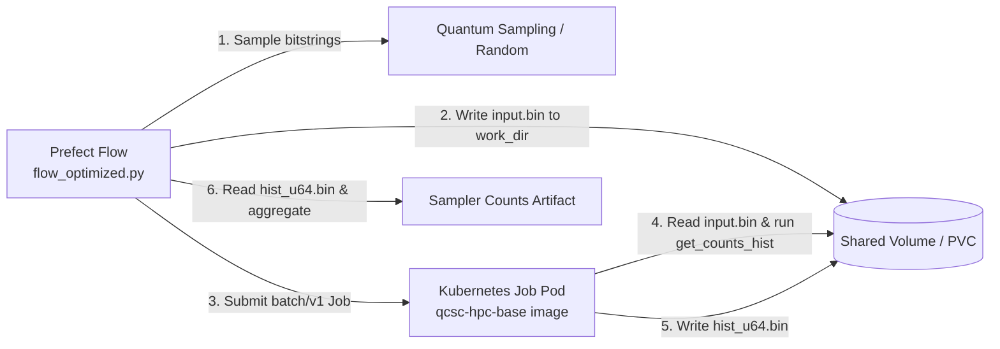

# Create Your QCSC Workflow with Prefect for Kubernetes

This hands-on tutorial guides you through running the BitCount demo on a Kubernetes cluster (such as kind, minikube, or a managed cloud Kubernetes cluster).
The compute payload executes as a Kubernetes `batch/v1` Job, while the workflow uses the exact same `qcsc-prefect` flow as the Miyabi, Fugaku, and Slurm tutorials.

Our objective is to compute a count dictionary of sampler bitstrings on Kubernetes using the QCSC architecture.



Key principles in this tutorial:

- Users do not write new Python flow code for Kubernetes.
- The same [`flow_optimized.py`](../../examples/prefect_bitcount_demo/flow_optimized.py) entrypoint is reused across all targets.
- A **generic HPC base image** (`qcsc-hpc-base:latest`) provides the OS toolchain and MPI runtime libraries, allowing multiple tutorials and custom code to run without rebuilding container images.
- Prefect blocks are created with `create_blocks.py --hpc-target kubernetes`.

---

## Prefect Core Concepts

You will see these terms:

- **Flow**: the end-to-end workflow entrypoint
  - `examples/prefect_bitcount_demo/flow_optimized.py`
- **Task**: individual units executed inside a flow
  - `quantum-sampling-task` in `flow_optimized.py`
  - `hpc-bitcount-task` in `flow_optimized.py`
- **Block**: reusable server-side configuration stored in Prefect
  - `CommandBlock`: `cmd-bitcount-hist`
  - `ExecutionProfileBlock`: `exec-bitcount-k8s`
  - `HPCProfileBlock`: `hpc-k8s-bitcount`
- **Variable**: server-side runtime parameters
  - `k8s-bitcount-options`

## What you need

- A running Kubernetes cluster (e.g., [kind](https://kind.sigs.k8s.io/), [minikube](https://minikube.sigs.k8s.io/), or a remote cluster)
- `kubectl` configured with cluster access
- Docker or Podman
- Python 3.11+ with `qcsc-prefect` installed (`uv sync --all-packages --extra kubernetes`)
- A running Prefect server or Prefect Cloud workspace

If you want to run against IBM Quantum Runtime later, you will also need:

- A configured `QuantumRuntime` block such as `ibm-runner`
- IBM Quantum credentials set up in the Prefect backend you use

---

## Existing files used in this tutorial

- `docker/Dockerfile.hpc-base`
- `docker/build_hpc_base.sh`
- `examples/prefect_bitcount_demo/src/get_counts_hist.cpp`
- `examples/prefect_bitcount_demo/create_blocks.py`
- `examples/prefect_bitcount_demo/flow_optimized.py`

---

## Step-by-Step Walkthrough

### Step 1. Build the Generic HPC Base Image

Build the generic HPC base image containing compilers, Open MPI, and system dependencies:

```bash
./docker/build_hpc_base.sh qcsc-hpc-base:latest
```

If you are using a local `kind` cluster, load the built image into the cluster:

```bash
kind load docker-image qcsc-hpc-base:latest
```

---

### Step 2. Build the BitCount Executable

Compile the C++ BitCount program to produce the binary histogram executable:

```bash
mkdir -p examples/prefect_bitcount_demo/bin

# Build with your local mpicxx or using the docker container:
docker run --rm -v "$(pwd):/work" -w /work qcsc-hpc-base:latest \
  mpicxx -O3 -std=c++17 \
  -o examples/prefect_bitcount_demo/bin/get_counts_hist \
  examples/prefect_bitcount_demo/src/get_counts_hist.cpp
```

Confirm the executable was created:

```bash
ls -l examples/prefect_bitcount_demo/bin/get_counts_hist
```

---

### Step 3. Create the Prefect Blocks for Kubernetes

Run `create_blocks.py` to create the required Prefect blocks and variables configured for Kubernetes:

```bash
python examples/prefect_bitcount_demo/create_blocks.py \
  --hpc-target kubernetes \
  --kubernetes-image qcsc-hpc-base:latest \
  --kubernetes-namespace default \
  --work-dir "$(pwd)/work/bitcount_k8s" \
  --optimized-executable "$(pwd)/examples/prefect_bitcount_demo/bin/get_counts_hist"
```

#### What this creates

| Type | Name | Purpose |
|---|---|---|
| `CommandBlock` | `cmd-bitcount-hist` | Command definition (`executable_key=bitcount_hist`) |
| `ExecutionProfileBlock` | `exec-bitcount-k8s` | Single pod launcher, resources, walltime |
| `HPCProfileBlock` | `hpc-k8s-bitcount` | Kubernetes target with container image, namespace, PVC, executable mapping |
| `Variable` | `k8s-bitcount-options` | Sampler options and base working directory |

---

### Step 4. Run the Optimized Flow

Run the flow using pseudo-random bitstrings for local verification:

```bash
python examples/prefect_bitcount_demo/flow_optimized.py \
  --quantum-source random \
  --command-block cmd-bitcount-hist \
  --execution-profile-block exec-bitcount-k8s \
  --hpc-profile-block hpc-k8s-bitcount \
  --options-variable k8s-bitcount-options
```

To run with real IBM Quantum hardware sampling (when configured):

```bash
python examples/prefect_bitcount_demo/flow_optimized.py \
  --quantum-source real-device \
  --runtime-block ibm-runner \
  --command-block cmd-bitcount-hist \
  --execution-profile-block exec-bitcount-k8s \
  --hpc-profile-block hpc-k8s-bitcount \
  --options-variable k8s-bitcount-options
```

---

### Step 5. Verify Output and Metrics

When the flow completes, it logs the output and returns a dictionary:

```text
{
  'mode': 'optimized',
  'job_id': 'default/prefect-bitcount-hist-...',
  'shots': 100000,
  'num_unique_bitstrings': 1024,
  'work_dir': '.../work/bitcount_k8s/job_...'
}
```

You can view the generated metrics and counts table in the Prefect UI under **Artifacts**:
- `bitcount-optimized-metrics` (Job state, exit status, duration, node/pod name)
- `sampler-count-dict-optimized` (Unique bitstrings and their frequencies)
