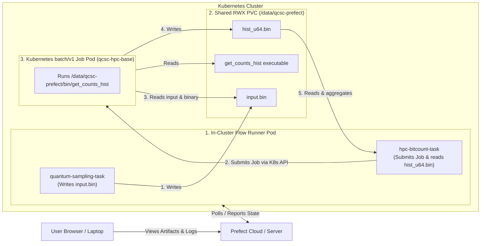
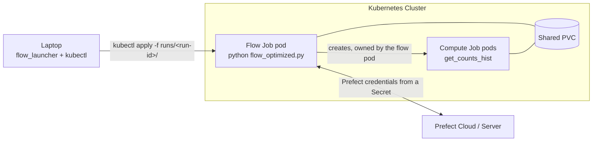

# Create Your QCSC Workflow with Prefect for Kubernetes

This hands-on tutorial guides you through running the BitCount demo exclusively on a Kubernetes cluster.
Both the Prefect flow process and the compute Job pods execute inside the Kubernetes cluster and share a common ReadWriteMany (RWX) PersistentVolumeClaim (PVC).

Our objective is to compute a count dictionary of sampler bitstrings on Kubernetes using the QCSC architecture.

---

## Architecture & Data Flow

In `qcsc-prefect`, the flow process runs inside a **Prefect runner pod** in the cluster, communicating directly with the in-cluster Kubernetes API to submit and monitor compute jobs. Both the runner pod and the compute job pods mount the exact same shared PVC at the same path:



Key principles in this tutorial:

- **Exclusively In-Cluster Execution**: The workflow runs inside a pod on the cluster so it has direct, identical access to the shared storage volume as the compute jobs.
- **Portability**: Uses the exact same [`flow_optimized.py`](../../examples/prefect_bitcount_demo/flow_optimized.py) entrypoint as the Miyabi, Fugaku, and Slurm tutorials.
- **Generic Base Image**: Uses `qcsc-hpc-base:latest` for both the runner environment and the job pods.
- **Block Integration**: Creates `CommandBlock`, `ExecutionProfileBlock`, and `HPCProfileBlock` using `create_blocks.py --hpc-target kubernetes`.

---

## Prefect Core Concepts

- **Flow**: the end-to-end workflow entrypoint
  - `examples/prefect_bitcount_demo/flow_optimized.py`
- **Task**: individual units executed inside a flow
  - `quantum-sampling-task` in `flow_optimized.py`: Quantum sampling and `input.bin` preparation
  - `hpc-bitcount-task` in `flow_optimized.py`: Kubernetes Job submission, status monitoring, and count aggregation
- **Block**: reusable server-side configuration stored in Prefect
  - `CommandBlock`: `cmd-bitcount-hist`
  - `ExecutionProfileBlock`: `exec-bitcount-k8s`
  - `HPCProfileBlock`: `hpc-k8s-bitcount`
- **Variable**: server-side runtime parameters
  - `k8s-bitcount-options`

---

## What you need

- **Container Engine**: **Docker Desktop** (or OrbStack) OR **Podman** (Podman Desktop / `podman machine`) running on macOS
- **`kind`** (Kubernetes in Docker) and **`kubectl`** CLI installed:
  - macOS (Homebrew): `brew install kind kubectl`
- A reachable **Prefect backend** (Prefect Cloud account or self-hosted Prefect server)

If you want to run against IBM Quantum Runtime later, you will also need:
- A configured `QuantumRuntime` block such as `ibm-runner`
- IBM Quantum credentials set up in Prefect

---

## Step 0. Start a Local `kind` Cluster

If you already have a Kubernetes cluster with a shared RWX storage class, you can proceed directly to [Step 1](#step-1-build-the-generic-hpc-base-image).

To create a local `kind` cluster with persistent host storage on your Mac:

1. **Create the shared storage directory under your home folder**:

```bash
mkdir -p "$HOME/qcsc-shared-storage"
```

> [!NOTE]
> On macOS, placing the directory under `$HOME` (e.g. `/Users/<username>`) ensures it is automatically shared with the Docker or Podman virtual machine.

2. **Generate the `kind-config.yaml` cluster configuration**:

```bash
cat <<EOF > kind-config.yaml
kind: Cluster
apiVersion: kind.x-k8s.io/v1alpha4
name: qcsc-cluster
nodes:
- role: control-plane
  extraMounts:
  - hostPath: $HOME/qcsc-shared-storage
    containerPath: /data/qcsc-storage
EOF
```

3. **Create the `kind` cluster**:

```bash
# When using Docker:
kind create cluster --config kind-config.yaml

# When using Podman:
KIND_EXPERIMENTAL_PROVIDER=podman kind create cluster --config kind-config.yaml
```

4. **Verify cluster readiness**:

```bash
kubectl get nodes
```

---

## Step 1. Build the Generic HPC Base Image

Build the generic base image containing compilers, Open MPI, Python, and system tools:

```bash
# When using Docker:
./docker/build_hpc_base.sh qcsc-hpc-base:latest

# When using Podman:
podman build -t qcsc-hpc-base:latest -f docker/Dockerfile.hpc-base .
```

Load the newly built image directly into the local `kind` cluster:

```bash
# When using Docker:
kind load docker-image qcsc-hpc-base:latest --name qcsc-cluster

# When using Podman (Podman prepends `localhost/` to local image names):
KIND_EXPERIMENTAL_PROVIDER=podman kind load docker-image localhost/qcsc-hpc-base:latest --name qcsc-cluster
```

*(For remote clusters, tag and push the image to your container registry).*

---

## Step 2. Deploy Cluster Infrastructure (PV, PVC, RBAC, Runner Pod)

Create and apply the `k8s-qcsc-setup.yaml` manifest containing the PersistentVolume, PersistentVolumeClaim, RBAC permissions, and the runner pod.

Select the snippet corresponding to your container runtime:

### Option A: Using Docker

```bash
cat <<EOF > k8s-qcsc-setup.yaml
apiVersion: v1
kind: PersistentVolume
metadata:
  name: qcsc-pv
spec:
  capacity:
    storage: 10Gi
  accessModes:
    - ReadWriteMany
  storageClassName: manual
  hostPath:
    path: /data/qcsc-storage
---
apiVersion: v1
kind: PersistentVolumeClaim
metadata:
  name: qcsc-shared-pvc
  namespace: default
spec:
  accessModes:
    - ReadWriteMany
  storageClassName: manual
  volumeName: qcsc-pv
  resources:
    requests:
      storage: 10Gi
---
apiVersion: v1
kind: ServiceAccount
metadata:
  name: qcsc-prefect-runner
  namespace: default
---
apiVersion: rbac.authorization.k8s.io/v1
kind: Role
metadata:
  name: qcsc-job-manager
  namespace: default
rules:
- apiGroups: ["batch"]
  resources: ["jobs", "jobs/status"]
  verbs: ["get", "list", "watch", "create", "delete"]
- apiGroups: [""]
  resources: ["pods", "pods/log", "pods/status"]
  verbs: ["get", "list", "watch"]
---
apiVersion: rbac.authorization.k8s.io/v1
kind: RoleBinding
metadata:
  name: qcsc-job-manager-binding
  namespace: default
subjects:
- kind: ServiceAccount
  name: qcsc-prefect-runner
  namespace: default
roleRef:
  kind: Role
  name: qcsc-job-manager
  apiGroup: rbac.authorization.k8s.io
---
apiVersion: v1
kind: Pod
metadata:
  name: qcsc-prefect-runner
  namespace: default
spec:
  serviceAccountName: qcsc-prefect-runner
  containers:
  - name: runner
    image: qcsc-hpc-base:latest
    imagePullPolicy: IfNotPresent
    command: ["/bin/bash", "-c", "sleep infinity"]
    volumeMounts:
    - name: shared-storage
      mountPath: /data/qcsc-prefect
  volumes:
  - name: shared-storage
    persistentVolumeClaim:
      claimName: qcsc-shared-pvc
EOF

kubectl apply -f k8s-qcsc-setup.yaml
```

### Option B: Using Podman

```bash
cat <<EOF > k8s-qcsc-setup.yaml
apiVersion: v1
kind: PersistentVolume
metadata:
  name: qcsc-pv
spec:
  capacity:
    storage: 10Gi
  accessModes:
    - ReadWriteMany
  storageClassName: manual
  hostPath:
    path: /data/qcsc-storage
---
apiVersion: v1
kind: PersistentVolumeClaim
metadata:
  name: qcsc-shared-pvc
  namespace: default
spec:
  accessModes:
    - ReadWriteMany
  storageClassName: manual
  volumeName: qcsc-pv
  resources:
    requests:
      storage: 10Gi
---
apiVersion: v1
kind: ServiceAccount
metadata:
  name: qcsc-prefect-runner
  namespace: default
---
apiVersion: rbac.authorization.k8s.io/v1
kind: Role
metadata:
  name: qcsc-job-manager
  namespace: default
rules:
- apiGroups: ["batch"]
  resources: ["jobs", "jobs/status"]
  verbs: ["get", "list", "watch", "create", "delete"]
- apiGroups: [""]
  resources: ["pods", "pods/log", "pods/status"]
  verbs: ["get", "list", "watch"]
---
apiVersion: rbac.authorization.k8s.io/v1
kind: RoleBinding
metadata:
  name: qcsc-job-manager-binding
  namespace: default
subjects:
- kind: ServiceAccount
  name: qcsc-prefect-runner
  namespace: default
roleRef:
  kind: Role
  name: qcsc-job-manager
  apiGroup: rbac.authorization.k8s.io
---
apiVersion: v1
kind: Pod
metadata:
  name: qcsc-prefect-runner
  namespace: default
spec:
  serviceAccountName: qcsc-prefect-runner
  containers:
  - name: runner
    image: localhost/qcsc-hpc-base:latest
    imagePullPolicy: IfNotPresent
    command: ["/bin/bash", "-c", "sleep infinity"]
    volumeMounts:
    - name: shared-storage
      mountPath: /data/qcsc-prefect
  volumes:
  - name: shared-storage
    persistentVolumeClaim:
      claimName: qcsc-shared-pvc
EOF

kubectl apply -f k8s-qcsc-setup.yaml
```

Verify that the runner pod is running:

```bash
kubectl get pod qcsc-prefect-runner
```

---

## Step 3. Connect to the In-Cluster Runner Pod

Open an interactive shell in the runner pod:

```bash
kubectl exec -it qcsc-prefect-runner -- bash
```

Inside the pod, navigate to the shared storage directory:

```bash
cd /data/qcsc-prefect
```

Clone or copy the `qcsc-prefect` repository onto the shared volume (if not already present):

```bash
git clone https://github.com/qiskit-community/qcsc-prefect.git .
```

Install Python package dependencies in a virtual environment on the shared volume:

```bash
python3 -m venv .venv
source .venv/bin/activate

# Clean any macOS AppleDouble metadata files if copied from macOS host
find . -name "._*" -delete

pip install -e packages/qcsc-prefect-core \
            -e "packages/qcsc-prefect-adapters[kubernetes]" \
            -e packages/qcsc-prefect-blocks \
            -e packages/qcsc-prefect-executor \
            -e packages/qcsc-prefect-qiskit \
            prefect-qiskit
```

---

## Step 4. Build the BitCount Executable

From inside the runner pod, compile `get_counts_hist.cpp` directly onto the shared volume:

```bash
mkdir -p /data/qcsc-prefect/examples/prefect_bitcount_demo/bin

mpicxx -O3 -std=c++17 \
  -o /data/qcsc-prefect/examples/prefect_bitcount_demo/bin/get_counts_hist \
  examples/prefect_bitcount_demo/src/get_counts_hist.cpp
```

Confirm the executable is present:

```bash
ls -l /data/qcsc-prefect/examples/prefect_bitcount_demo/bin/get_counts_hist
```

---

## Step 5. Log in to Prefect and Create Blocks

Inside the runner pod shell, log in to your Prefect workspace (e.g. Prefect Cloud):

```bash
prefect cloud login --key "<PREFECT_API_KEY>"
```

Run `create_blocks.py` to register the Kubernetes blocks and variables:

```bash
# When using Docker:
python examples/prefect_bitcount_demo/create_blocks.py \
  --hpc-target kubernetes \
  --kubernetes-image qcsc-hpc-base:latest \
  --kubernetes-namespace default \
  --kubernetes-work-volume-claim qcsc-shared-pvc \
  --kubernetes-work-mount-path /data/qcsc-prefect \
  --work-dir /data/qcsc-prefect/work/bitcount_k8s \
  --optimized-executable /data/qcsc-prefect/examples/prefect_bitcount_demo/bin/get_counts_hist

# When using Podman (use localhost/ image prefix):
python examples/prefect_bitcount_demo/create_blocks.py \
  --hpc-target kubernetes \
  --kubernetes-image localhost/qcsc-hpc-base:latest \
  --kubernetes-namespace default \
  --kubernetes-work-volume-claim qcsc-shared-pvc \
  --kubernetes-work-mount-path /data/qcsc-prefect \
  --work-dir /data/qcsc-prefect/work/bitcount_k8s \
  --optimized-executable /data/qcsc-prefect/examples/prefect_bitcount_demo/bin/get_counts_hist
```

### Registered Blocks & Variables

| Block / Variable | Name | Purpose |
|---|---|---|
| `CommandBlock` | `cmd-bitcount-hist` | Command definition (`executable_key=bitcount_hist`) |
| `ExecutionProfileBlock` | `exec-bitcount-k8s` | Pod launcher configuration and CPU/memory limits |
| `HPCProfileBlock` | `hpc-k8s-bitcount` | Kubernetes execution target, container image, and shared PVC |
| `Variable` | `k8s-bitcount-options` | Sampler options and base working directory |

---

## Step 6. Run the Optimized Flow

From inside the runner pod, execute the flow using deterministic random bitstrings:

```bash
python examples/prefect_bitcount_demo/flow_optimized.py \
  --quantum-source random \
  --command-block cmd-bitcount-hist \
  --execution-profile-block exec-bitcount-k8s \
  --hpc-profile-block hpc-k8s-bitcount \
  --options-variable k8s-bitcount-options \
  --work-dir /data/qcsc-prefect/work/bitcount_k8s
```

Or execute against IBM Quantum real hardware:

```bash
python examples/prefect_bitcount_demo/flow_optimized.py \
  --quantum-source real-device \
  --runtime-block ibm-runner \
  --command-block cmd-bitcount-hist \
  --execution-profile-block exec-bitcount-k8s \
  --hpc-profile-block hpc-k8s-bitcount \
  --options-variable k8s-bitcount-options \
  --work-dir /data/qcsc-prefect/work/bitcount_k8s
```

---

## Step 7. Verify Results & Inspect Artifacts

When `flow_optimized.py` finishes, it returns a summary dictionary:

```text
{
  'mode': 'optimized',
  'job_id': 'default/prefect-bitcount-hist-...',
  'shots': 100000,
  'num_unique_bitstrings': 1024,
  'work_dir': '/data/qcsc-prefect/work/bitcount_k8s/job_20260408_...'
}
```

In your browser on the Prefect UI, navigate to the completed flow run and inspect the **Artifacts**:
- **`bitcount-optimized-metrics`**: Shows job ID, execution state (`COMPLETED`), exit code (`0`), duration, pod name, and node name.
- **`sampler-count-dict-optimized`**: Shows the full table of unique bitstrings and calculated counts produced by the Kubernetes compute job.

---

## Optional: Run the Flow as a Batch Job from Your Laptop

Steps 3 to 6 run the flow from an interactive shell in the runner pod. For a non-interactive run, launch the flow itself as a Kubernetes Job. The flow still runs in the cluster, next to the compute Jobs and the shared PVC, but your laptop does not have to stay connected.



### Prerequisites

- Steps 1 to 5 are done: the repository and virtual environment are on the shared volume, and the blocks exist.
- `kubectl` on your laptop points at the cluster and can read Secrets in the block's namespace.
- The launcher and the packages it imports are installed on the laptop, and your active Prefect profile points at the same Prefect API as the flow pod will use:
  ```bash
  uv pip install -e packages/qcsc-prefect-core -e "packages/qcsc-prefect-adapters[kubernetes]" \
    -e packages/qcsc-prefect-blocks -e packages/qcsc-prefect-executor
  ```
- The `HPCProfileBlock` sets `kubernetes_image`, `kubernetes_namespace`, `kubernetes_work_volume_claim` and `kubernetes_work_mount_path`. The flow pod is built from this block.
- The flow pod needs a service account that may create Jobs, such as `qcsc-prefect-runner`. You pass it to the launcher with `--service-account`. Leave `kubernetes_service_account_name` on the block empty or set it to an account without Job rights, so the compute pods do not inherit Job-create access.
- Store the Prefect credentials in a Secret in the block's namespace. The compute Jobs do not need it.

```bash
kubectl create secret generic prefect-credentials \
  --from-literal=PREFECT_API_URL="<PREFECT_API_URL>" \
  --from-literal=PREFECT_API_KEY="<PREFECT_API_KEY>"
```

> [!IMPORTANT]
> `--work-dir` must be inside the PVC mount path as the pods see it. The launcher and the Job builder reject a work directory outside the block's `kubernetes_work_mount_path`, because that directory does not exist in the pod.

### Launch

```bash
python -m qcsc_prefect_executor.kubernetes.flow_launcher \
  --service-account qcsc-prefect-runner \
  --env-from-secret prefect-credentials \
  -- /data/qcsc-prefect/.venv/bin/python \
     /data/qcsc-prefect/examples/prefect_bitcount_demo/flow_optimized.py \
     --quantum-source random \
     --command-block cmd-bitcount-hist \
     --execution-profile-block exec-bitcount-k8s \
     --hpc-profile-block hpc-k8s-bitcount \
     --options-variable k8s-bitcount-options \
     --work-dir /data/qcsc-prefect/work/bitcount_k8s
```

Everything after `--` is the flow command, so the launcher works for any flow, not only BitCount. Copy the command with its trailing `\` characters; a pasted line break ends the command early.

### One profile block for the flow pod and its Jobs

The flow pod must run on the same cluster, in the same namespace and with the same PVC as the compute Jobs it creates. The launcher therefore takes the image, namespace, node selector, tolerations, pull settings and shared volume from the `HPCProfileBlock`, and has no flags for those values.

The service account is the one exception. The flow pod must be able to create Jobs, but the compute pods only run a program, so they should not have that right. `--service-account` is therefore a required launcher option and is not read from the block. The block's `kubernetes_service_account_name` applies to the compute pods only, and changing it does not count as an edited block.

You name the block once. The launcher reads it from the `--hpc-profile-block` in the flow command. Pass the launcher's own `--hpc-profile-block NAME` before the `--` only if the flow command does not name a block; the launcher stops with an error if neither does, or if both name different blocks. The block must have `hpc_target="kubernetes"`, `kubernetes_image`, `kubernetes_work_volume_claim` and `kubernetes_work_mount_path`, or the launcher stops.

Three checks keep the flow pod and the compute Jobs consistent:

| Check | When | What happens on a mismatch |
|---|---|---|
| Same Prefect API | At launch, on the laptop | The launcher reads `PREFECT_API_URL` from the Secret named by `--env-from-secret` with `kubectl get secret`, and compares it with your active Prefect profile. If they differ, it prints both URLs and the profile name, and writes nothing. Fix it with `prefect profile use <name>` or by updating the Secret. |
| Same block name | At launch, and in the pod | If the launcher's `--hpc-profile-block` differs from the flow command's, the launcher stops. In the pod, the flow raises an error for any job whose effective `hpc_profile_block` is another block, including per-job overrides in bulk runs. |
| Block not edited since render | In the pod, before the first Job | The launcher stores a fingerprint of the pod-level block fields in the manifest (`QCSC_HPC_PROFILE_FINGERPRINT`). If you edit those fields in Prefect and then run `kubectl apply` on the old YAML, the flow fails before it creates any Job and tells you to launch again. Fields that only affect the compute Jobs (CPU, memory, labels) are not part of the fingerprint. |

Because the last check runs in the pod, a plain `kubectl apply -f runs/<run-id>/` is safe, even days after the YAML was rendered.

The launcher writes `runs/<run-id>/flow-job.yaml`, prints the commands below, and asks whether to launch it. Pass `--launch` or `--no-launch` to skip the question. Without a terminal and without either flag, it writes the file and does not launch.

| Action | Command |
|---|---|
| Start | `kubectl apply -f runs/<run-id>/` |
| Follow logs | `kubectl logs -n <namespace> -f job/<run-id>` |
| Stop and clean up | `kubectl delete -f runs/<run-id>/` |
| Fallback cleanup | `kubectl delete jobs -n <namespace> -l qcsc-prefect/flow-run=<run-id>` |

### How cleanup works

`kubectl delete -f runs/<run-id>/` deletes only the flow Job. The compute Jobs are created while the flow runs, so they cannot be in that folder. Two mechanisms cover them:

1. **Owner reference.** The flow pod passes its own name and UID to the code that creates compute Jobs (`QCSC_OWNER_POD_NAME`, `QCSC_OWNER_POD_UID`). Each compute Job is owned by the flow pod, so Kubernetes garbage-collects it when the flow pod is deleted.
2. **Label.** Every Job of the run carries `qcsc-prefect/flow-run=<run-id>`. If garbage collection does not remove something, delete by label with the fallback command above.

The Prefect credentials Secret, the service account and the PVC are shared between runs and are not part of the run folder.

> [!NOTE]
> The flow Job uses `backoffLimit: 0`, so a failed flow is never retried automatically and compute Jobs are not submitted twice. After `kubectl delete`, the flow run may stay in the `Running` state in the Prefect UI until Prefect marks it as crashed.

---

## Troubleshooting & Tips

### 1. 403 Forbidden: Cannot get resource `jobs/status`
- **Symptom**:
  ```text
  ApiException: (403) Reason: Forbidden
  User "system:serviceaccount:default:qcsc-prefect-runner" cannot get resource "jobs/status" in API group "batch"
  ```
- **Cause**: Kubernetes treats `jobs/status`, `pods/status`, and `pods/log` as subresources that require explicit permissions in the RBAC `Role`.
- **Solution**: Ensure your `Role` contains both resources and their subresources:
  ```yaml
  rules:
  - apiGroups: ["batch"]
    resources: ["jobs", "jobs/status"]
    verbs: ["get", "list", "watch", "create", "delete"]
  - apiGroups: [""]
    resources: ["pods", "pods/log", "pods/status"]
    verbs: ["get", "list", "watch"]
  ```

### 2. AppleDouble (`._*`) Files and `UnicodeDecodeError` in Pip
- **Symptom**:
  ```text
  UserWarning: .../._qcsc_prefect_adapters.egg-info could not be properly decoded in UTF-8
  UnicodeDecodeError: 'utf-8' codec can't decode byte 0xa3 in position 45
  ```
- **Cause**: When files are mounted or copied from macOS into the container, macOS creates hidden `._*` AppleDouble binary metadata files. Python's `importlib.metadata` and `pip` attempt to parse these as UTF-8 package metadata files and fail.
- **Solution**: Remove the AppleDouble files and any corrupted `.egg-info` directories before installing:
  ```bash
  find /data/qcsc-prefect -name "._*" -delete
  find /data/qcsc-prefect -name "*.egg-info" -exec rm -rf {} +
  ```

### 3. `ModuleNotFoundError: No module named 'prefect_qiskit'`
- **Explanation**:
  - `packages/qcsc-prefect-qiskit` is the local monorepo package (imported as `qcsc_prefect.integrations.qiskit`).
  - `prefect-qiskit` is the external PyPI package providing `prefect_qiskit.QuantumRuntime`.
- **Solution**:
  - For pseudo-random simulation (`--quantum-source random`), `prefect-qiskit` is not required.
  - For real hardware execution (`--quantum-source real-device`), install `prefect-qiskit`:
    ```bash
    pip install prefect-qiskit
    ```

### 4. Local Kind Images and `imagePullPolicy: IfNotPresent`
- **Symptom**:
  ```text
  ErrImagePull / ImagePullBackOff: Failed to pull image "qcsc-hpc-base:latest": failed to resolve reference ...
  ```
- **Cause**: Kubernetes defaults `imagePullPolicy` to `Always` whenever an image uses the `:latest` tag (or has no tag). This causes kubelet to attempt to download the image from a remote registry (e.g., Docker Hub) instead of using the local image pre-loaded into the `kind` node.
- **Solution**: Both `k8s-qcsc-setup.yaml` and `create_blocks.py` default `imagePullPolicy` to `IfNotPresent`. If creating custom Job templates, always set:
  ```yaml
  image: qcsc-hpc-base:latest
  imagePullPolicy: IfNotPresent
  ```

---

### 5. `working_dir ... is not inside work_mount_path`
- **Symptom**:
  ```text
  ValueError: working_dir '/data/qcsc-prefect/work/bitcount_k8s/job_...' is not inside work_mount_path '/ldata'.
  ```
- **Cause**: The work directory (from `--work-dir` or the options Variable) is outside the path where the PVC is mounted in the Job pod, so it does not exist there. Before this check, such a Job was created and then failed at container start (observed as exit code 255 with `workingDir` under `/data/qcsc-prefect` and the PVC mounted at `/ldata`).
- **Solution**: Make `--work-dir`, the options Variable `work_dir`, and `--kubernetes-work-mount-path` agree, for example all under `/ldata`. Re-run `create_blocks.py` after changing them.

### 6. Podman Tips on macOS
- **Provider Flag**: `kind` requires `KIND_EXPERIMENTAL_PROVIDER=podman` when using Podman as the container engine (e.g. `KIND_EXPERIMENTAL_PROVIDER=podman kind create cluster ...`).
- **Image Names**: Podman prefixes locally built images with `localhost/` (e.g., `localhost/qcsc-hpc-base:latest`). Always use `localhost/qcsc-hpc-base:latest` in `k8s-qcsc-setup.yaml` and `--kubernetes-image` in `create_blocks.py` so kubelet finds the pre-loaded image in kind without attempting to query a remote registry.
- **Machine Storage**: Podman machines on macOS only mount directories under `$HOME` into the VM by default. Always keep the host shared storage under `$HOME` (e.g. `$HOME/qcsc-shared-storage`).

---

## Step 8. Cleaning Up

When you are finished with the tutorial, you can tear down all local resources:

1. **Delete cluster resources**:
```bash
kubectl delete -f k8s-qcsc-setup.yaml
```

2. **Delete the `kind` cluster**:
```bash
# When using Docker:
kind delete cluster --name qcsc-cluster

# When using Podman:
KIND_EXPERIMENTAL_PROVIDER=podman kind delete cluster --name qcsc-cluster
```

3. **(Optional) Clean up local storage and generated configs**:
```bash
rm -rf "$HOME/qcsc-shared-storage"
rm -f kind-config.yaml k8s-qcsc-setup.yaml
```
