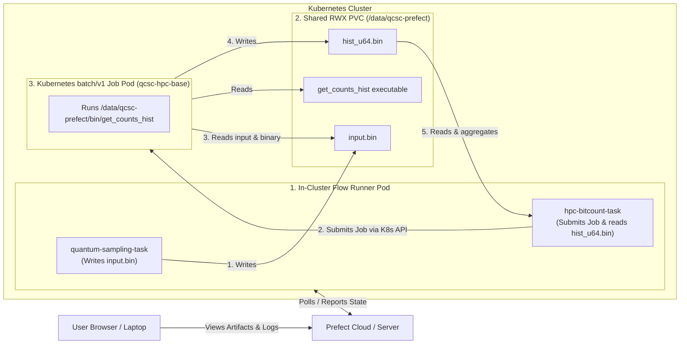

# Create Your QCSC Workflow with Prefect for Kubernetes

This hands-on tutorial guides you through running the BitCount demo exclusively on a Kubernetes cluster.
Both the Prefect flow process and the compute Job pods execute inside the Kubernetes cluster and share a common ReadWriteMany (RWX) PersistentVolumeClaim (PVC).

Our objective is to compute a count dictionary of sampler bitstrings on Kubernetes using the QCSC architecture.

---

## Architecture & Data Flow

In `qcsc-prefect`, the flow process runs inside a **Prefect runner pod** in the cluster, communicating directly with the in-cluster Kubernetes API to submit and monitor compute jobs. Both the runner pod and the compute job pods mount the exact same shared PVC at the same path:



Key principles in this tutorial:

- **Exclusively In-Cluster Execution**: The workflow runs inside a pod on the cluster so it has direct, identical access to the shared storage volume as the compute jobs.
- **Portability**: Uses the exact same [`flow_optimized.py`](../../examples/prefect_bitcount_demo/flow_optimized.py) entrypoint as the Miyabi, Fugaku, and Slurm tutorials.
- **Generic Base Image**: Uses `qcsc-hpc-base:latest` for both the runner environment and the job pods.
- **Block Integration**: Creates `CommandBlock`, `ExecutionProfileBlock`, and `HPCProfileBlock` using `create_blocks.py --hpc-target kubernetes`.

---

## Prefect Core Concepts

- **Flow**: the end-to-end workflow entrypoint
  - `examples/prefect_bitcount_demo/flow_optimized.py`
- **Task**: individual units executed inside a flow
  - `quantum-sampling-task` in `flow_optimized.py`: Quantum sampling and `input.bin` preparation
  - `hpc-bitcount-task` in `flow_optimized.py`: Kubernetes Job submission, status monitoring, and count aggregation
- **Block**: reusable server-side configuration stored in Prefect
  - `CommandBlock`: `cmd-bitcount-hist`
  - `ExecutionProfileBlock`: `exec-bitcount-k8s`
  - `HPCProfileBlock`: `hpc-k8s-bitcount`
- **Variable**: server-side runtime parameters
  - `k8s-bitcount-options`

---

## What you need

- Docker or Podman (e.g. Docker Desktop or Podman Desktop)
- `kind` (Kubernetes in Docker) and `kubectl` CLI installed:
  - macOS (Homebrew): `brew install kind kubectl`
- A reachable Prefect backend (Prefect Cloud account or self-hosted Prefect server)

If you want to run against IBM Quantum Runtime later, you will also need:
- A configured `QuantumRuntime` block such as `ibm-runner`
- IBM Quantum credentials set up in Prefect

---

## Step 0. Start a Local `kind` Cluster

If you already have a Kubernetes cluster with a shared RWX storage class, you can proceed directly to [Step 1](#step-1-build-the-generic-hpc-base-image).

To create a local `kind` cluster with persistent host storage on your laptop:

1. **Create the shared storage directory under your home folder**:

```bash
mkdir -p "$HOME/qcsc-shared-storage"
```

> [!NOTE]
> When using Podman on macOS, placing the directory under `$HOME` ensures it is mounted into the Podman virtual machine.

2. **Create the `kind-config.yaml` cluster definition**:

```yaml
kind: Cluster
apiVersion: kind.x-k8s.io/v1alpha4
name: qcsc-cluster
nodes:
- role: control-plane
  extraMounts:
  - hostPath: /path/to/qcsc-shared-storage # Replace with your $HOME/qcsc-shared-storage absolute path
    containerPath: /data/qcsc-storage
```

3. **Create the kind cluster**:

```bash
# Substitute your actual $HOME path in the config
cat <<EOF > kind-config.yaml
kind: Cluster
apiVersion: kind.x-k8s.io/v1alpha4
name: qcsc-cluster
nodes:
- role: control-plane
  extraMounts:
  - hostPath: $HOME/qcsc-shared-storage
    containerPath: /data/qcsc-storage
EOF

kind create cluster --config kind-config.yaml
```

4. **Verify cluster readiness**:

```bash
kubectl get nodes
```

---

## Step 1. Build the Generic HPC Base Image

Build the generic base image containing compilers, Open MPI, Python, and system tools:

```bash
./docker/build_hpc_base.sh qcsc-hpc-base:latest
```

If using a local `kind` cluster:

```bash
# When using Docker:
kind load docker-image qcsc-hpc-base:latest

# When using Podman (Podman prepends `localhost/` to local image names):
kind load docker-image localhost/qcsc-hpc-base:latest
```

> [!TIP]
> If you built the image with Podman, use `localhost/qcsc-hpc-base:latest` as the image name in all manifests and `create_blocks.py` calls so Kubernetes matches the locally loaded image without attempting to pull from Docker Hub.

*(For remote clusters, tag and push the image to your container registry).*

---

## Step 2. Deploy Cluster Infrastructure (PV, PVC, RBAC, Runner Pod)

Create a single manifest `k8s-qcsc-setup.yaml` containing the PersistentVolume, PersistentVolumeClaim, RBAC permissions, and the runner pod:

```yaml
apiVersion: v1
kind: PersistentVolume
metadata:
  name: qcsc-pv
spec:
  capacity:
    storage: 10Gi
  accessModes:
    - ReadWriteMany
  storageClassName: manual
  hostPath:
    path: /data/qcsc-storage
---
apiVersion: v1
kind: PersistentVolumeClaim
metadata:
  name: qcsc-shared-pvc
  namespace: default
spec:
  accessModes:
    - ReadWriteMany
  storageClassName: manual
  volumeName: qcsc-pv
  resources:
    requests:
      storage: 10Gi
---
apiVersion: v1
kind: ServiceAccount
metadata:
  name: qcsc-prefect-runner
  namespace: default
---
apiVersion: rbac.authorization.k8s.io/v1
kind: Role
metadata:
  name: qcsc-job-manager
  namespace: default
rules:
- apiGroups: ["batch"]
  resources: ["jobs", "jobs/status"]
  verbs: ["get", "list", "watch", "create", "delete"]
- apiGroups: [""]
  resources: ["pods", "pods/log", "pods/status"]
  verbs: ["get", "list", "watch"]
---
apiVersion: rbac.authorization.k8s.io/v1
kind: RoleBinding
metadata:
  name: qcsc-job-manager-binding
  namespace: default
subjects:
- kind: ServiceAccount
  name: qcsc-prefect-runner
  namespace: default
roleRef:
  kind: Role
  name: qcsc-job-manager
  apiGroup: rbac.authorization.k8s.io
---
apiVersion: v1
kind: Pod
metadata:
  name: qcsc-prefect-runner
  namespace: default
spec:
  serviceAccountName: qcsc-prefect-runner
  containers:
  - name: runner
    image: qcsc-hpc-base:latest # or localhost/qcsc-hpc-base:latest when using Podman
    imagePullPolicy: IfNotPresent
    command: ["/bin/bash", "-c", "sleep infinity"]
    volumeMounts:
    - name: shared-storage
      mountPath: /data/qcsc-prefect
  volumes:
  - name: shared-storage
    persistentVolumeClaim:
      claimName: qcsc-shared-pvc
```

Apply the setup to your Kubernetes cluster:

```bash
kubectl apply -f k8s-qcsc-setup.yaml
```

Verify that the runner pod is running:

```bash
kubectl get pod qcsc-prefect-runner
```

---

## Step 3. Connect to the In-Cluster Runner Pod

Open an interactive shell in the runner pod:

```bash
kubectl exec -it qcsc-prefect-runner -- bash
```

Inside the pod, navigate to the shared storage directory:

```bash
cd /data/qcsc-prefect
```

Clone or copy the `qcsc-prefect` repository onto the shared volume (if not already present):

```bash
git clone https://github.com/qiskit-community/qcsc-prefect.git .
```

Install Python package dependencies in a virtual environment on the shared volume:

```bash
python3 -m venv .venv
source .venv/bin/activate

# Clean any macOS AppleDouble metadata files if copied from macOS host
find . -name "._*" -delete

pip install -e packages/qcsc-prefect-core \
            -e "packages/qcsc-prefect-adapters[kubernetes]" \
            -e packages/qcsc-prefect-blocks \
            -e packages/qcsc-prefect-executor \
            -e packages/qcsc-prefect-qiskit \
            prefect-qiskit
```

---

## Step 4. Build the BitCount Executable

From inside the runner pod, compile `get_counts_hist.cpp` directly onto the shared volume:

```bash
mkdir -p /data/qcsc-prefect/examples/prefect_bitcount_demo/bin

mpicxx -O3 -std=c++17 \
  -o /data/qcsc-prefect/examples/prefect_bitcount_demo/bin/get_counts_hist \
  examples/prefect_bitcount_demo/src/get_counts_hist.cpp
```

Confirm the executable is present:

```bash
ls -l /data/qcsc-prefect/examples/prefect_bitcount_demo/bin/get_counts_hist
```

---

## Step 5. Log in to Prefect and Create Blocks

Inside the runner pod shell, log in to your Prefect workspace (e.g. Prefect Cloud):

```bash
prefect cloud login --key "<PREFECT_API_KEY>"
```

Run `create_blocks.py` to register the Kubernetes blocks and variables:

```bash
# If using Docker: --kubernetes-image qcsc-hpc-base:latest
# If using Podman: --kubernetes-image localhost/qcsc-hpc-base:latest
python examples/prefect_bitcount_demo/create_blocks.py \
  --hpc-target kubernetes \
  --kubernetes-image localhost/qcsc-hpc-base:latest \
  --kubernetes-namespace default \
  --kubernetes-work-volume-claim qcsc-shared-pvc \
  --kubernetes-work-mount-path /data/qcsc-prefect \
  --work-dir /data/qcsc-prefect/work/bitcount_k8s \
  --optimized-executable /data/qcsc-prefect/examples/prefect_bitcount_demo/bin/get_counts_hist
```

### Registered Blocks & Variables

| Block / Variable | Name | Purpose |
|---|---|---|
| `CommandBlock` | `cmd-bitcount-hist` | Command definition (`executable_key=bitcount_hist`) |
| `ExecutionProfileBlock` | `exec-bitcount-k8s` | Pod launcher configuration and CPU/memory limits |
| `HPCProfileBlock` | `hpc-k8s-bitcount` | Kubernetes execution target, container image, and shared PVC |
| `Variable` | `k8s-bitcount-options` | Sampler options and base working directory |

---

## Step 6. Run the Optimized Flow

From inside the runner pod, execute the flow using deterministic random bitstrings:

```bash
python examples/prefect_bitcount_demo/flow_optimized.py \
  --quantum-source random \
  --command-block cmd-bitcount-hist \
  --execution-profile-block exec-bitcount-k8s \
  --hpc-profile-block hpc-k8s-bitcount \
  --options-variable k8s-bitcount-options \
  --work-dir /data/qcsc-prefect/work/bitcount_k8s
```

Or execute against IBM Quantum real hardware:

```bash
python examples/prefect_bitcount_demo/flow_optimized.py \
  --quantum-source real-device \
  --runtime-block ibm-runner \
  --command-block cmd-bitcount-hist \
  --execution-profile-block exec-bitcount-k8s \
  --hpc-profile-block hpc-k8s-bitcount \
  --options-variable k8s-bitcount-options \
  --work-dir /data/qcsc-prefect/work/bitcount_k8s
```

---

## Step 7. Verify Results & Inspect Artifacts

When `flow_optimized.py` finishes, it returns a summary dictionary:

```text
{
  'mode': 'optimized',
  'job_id': 'default/prefect-bitcount-hist-...',
  'shots': 100000,
  'num_unique_bitstrings': 1024,
  'work_dir': '/data/qcsc-prefect/work/bitcount_k8s/job_20260408_...'
}
```

In your browser on the Prefect UI, navigate to the completed flow run and inspect the **Artifacts**:
- **`bitcount-optimized-metrics`**: Shows job ID, execution state (`COMPLETED`), exit code (`0`), duration, pod name, and node name.
- **`sampler-count-dict-optimized`**: Shows the full table of unique bitstrings and calculated counts produced by the Kubernetes compute job.

---

## Troubleshooting & Tips

### 1. 403 Forbidden: Cannot get resource `jobs/status`
- **Symptom**:
  ```text
  ApiException: (403) Reason: Forbidden
  User "system:serviceaccount:default:qcsc-prefect-runner" cannot get resource "jobs/status" in API group "batch"
  ```
- **Cause**: Kubernetes treats `jobs/status`, `pods/status`, and `pods/log` as subresources that require explicit permissions in the RBAC `Role`.
- **Solution**: Ensure your `Role` contains both resources and their subresources:
  ```yaml
  rules:
  - apiGroups: ["batch"]
    resources: ["jobs", "jobs/status"]
    verbs: ["get", "list", "watch", "create", "delete"]
  - apiGroups: [""]
    resources: ["pods", "pods/log", "pods/status"]
    verbs: ["get", "list", "watch"]
  ```

### 2. AppleDouble (`._*`) Files and `UnicodeDecodeError` in Pip
- **Symptom**:
  ```text
  UserWarning: .../._qcsc_prefect_adapters.egg-info could not be properly decoded in UTF-8
  UnicodeDecodeError: 'utf-8' codec can't decode byte 0xa3 in position 45
  ```
- **Cause**: When files are mounted or copied from macOS into the container, macOS creates hidden `._*` AppleDouble binary metadata files. Python's `importlib.metadata` and `pip` attempt to parse these as UTF-8 package metadata files and fail.
- **Solution**: Remove the AppleDouble files and any corrupted `.egg-info` directories before installing:
  ```bash
  find /data/qcsc-prefect -name "._*" -delete
  find /data/qcsc-prefect -name "*.egg-info" -exec rm -rf {} +
  ```

### 3. `ModuleNotFoundError: No module named 'prefect_qiskit'`
- **Explanation**:
  - `packages/qcsc-prefect-qiskit` is the local monorepo package (imported as `qcsc_prefect.integrations.qiskit`).
  - `prefect-qiskit` is the external PyPI package providing `prefect_qiskit.QuantumRuntime`.
- **Solution**:
  - For pseudo-random simulation (`--quantum-source random`), `prefect-qiskit` is not required.
  - For real hardware execution (`--quantum-source real-device`), install `prefect-qiskit`:
    ```bash
    pip install prefect-qiskit
    ```

### 4. Podman on macOS Host Storage and Image Names
- **Storage Path**: Podman machine on macOS only mounts directories under `$HOME` by default. Always create the shared storage under `$HOME` (e.g. `$HOME/qcsc-shared-storage`), not under `/tmp`.
- **Image Naming**: Podman prefixes locally built images with `localhost/` (e.g. `localhost/qcsc-hpc-base:latest`). When loading into `kind`, specify `localhost/qcsc-hpc-base:latest` in `k8s-qcsc-setup.yaml` and `--kubernetes-image` in `create_blocks.py` so Kubernetes does not attempt to pull from Docker Hub.

### 5. `Failed to pull image "localhost/...": connection refused`
- **Symptom**:
  ```text
  Failed to pull image "localhost/qcsc-hpc-base:latest": failed to resolve reference: failed to do request: Head "https://localhost/v2/...": connect: connection refused
  ```
- **Cause**: Kubernetes defaults `imagePullPolicy` to `Always` whenever the image tag is `:latest` (or omitted). This causes kubelet to query a remote registry at `localhost:443` rather than using the pre-loaded image in `kind`.
- **Solution**: Set `kubernetes_image_pull_policy="IfNotPresent"` (configured by default in `create_blocks.py`) so kubelet utilizes the locally loaded image without making network requests.

---

## Step 8. Cleaning Up

When you are finished with the tutorial, you can tear down the resources:

1. **Delete cluster resources**:
```bash
kubectl delete -f k8s-qcsc-setup.yaml
```

2. **Delete the `kind` cluster**:
```bash
kind delete cluster --name qcsc-cluster
```

3. **(Optional) Clean up local storage and image**:
```bash
rm -rf "$HOME/qcsc-shared-storage"
rm -f kind-config.yaml
```
