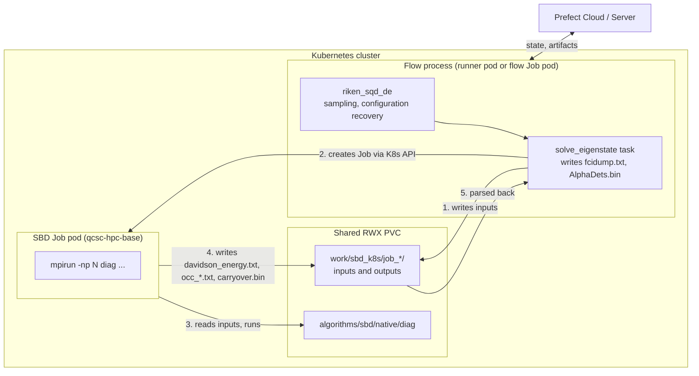
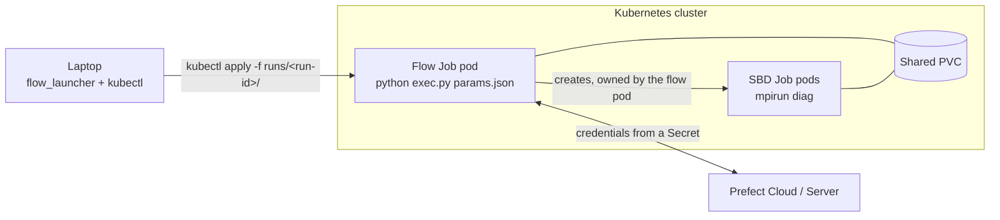

# Run SBD Closed-loop Workflow on Kubernetes (qcsc-prefect)

This tutorial runs the Sample-based Quantum Diagonalization (SQD) closed-loop workflow on a Kubernetes cluster.
The workflow samples bitstrings, recovers configurations, and diagonalizes the sparse chemistry Hamiltonian with the [SBD](https://github.com/r-ccs-cms/sbd) solver (`diag`).
Prefect orchestrates the run, and every SBD diagonalization runs as a Kubernetes `batch/v1` Job.

You will run the same workflow in two ways:

| Method | Where the Prefect flow runs | Best for |
|---|---|---|
| [**A. Interactive**](#method-a-interactive-run-from-the-runner-pod) | In a shell inside the long-lived runner pod | Developing, debugging, first runs |
| [**B. Batch**](#method-b-batch-run-with-the-flow-launcher) | In a Kubernetes Job rendered by `flow_launcher` | Unattended runs, repeatable runs, runs that outlive your laptop |

The solver, the Blocks, and the shared volume are identical for both methods. Only the way the flow process is started differs.

> [!TIP]
> Start with `quantum_source` set to `random`. It validates the whole classical pipeline and the Kubernetes execution path without IBM Quantum access.
> After it works, rerun with `real-device`.

---

## Prerequisites

- You completed one of the Kubernetes setup tutorials, so that you have:
  - [Create Your QCSC Workflow with Prefect for Kubernetes](./create_qcsc_workflow_for_kubernetes.md) (`kind`), or [the EKS version](./create_qcsc_workflow_for_eks.md)
  - a ReadWriteMany PVC, a `qcsc-prefect-runner` service account that can create Jobs, and a running `qcsc-prefect-runner` pod
  - a Prefect backend you can log in to
- The `qcsc-hpc-base` image includes **OpenBLAS** (`libopenblas-dev`). The SBD solver links against it, and the Job pods run the same image. If you built your image before this requirement, see [Step 1](#step-1-rebuild-the-base-image-with-openblas).
- For `real-device` runs only: a `QuantumRuntime` block such as `ibm-runner` (see [How to Set Up IBM Quantum Access Credentials for Prefect](../howto/howto_setup_prefect_qiskit.md)).

Commands below use these example values. Replace them with the values from your setup:

| Setting | Example in this tutorial | Where it comes from |
|---|---|---|
| Namespace | `default` | Your runner pod's namespace |
| PVC | `qcsc-shared-pvc` | Your PVC |
| PVC mount path | `/data/qcsc-prefect` | `mountPath` in the runner pod |
| Image | `<REGISTRY>/qcsc-hpc-base:latest` | The image you pushed |
| Job service account | `qcsc-prefect-runner` | Used for the flow pod in Method B only |

> [!IMPORTANT]
> The runner pod, the flow pod (Method B), and every SBD Job pod must mount the PVC at the **same path**. `work_dir`, `sbd_executable`, and the FCIDump path must all be under that path.

---

## 1. How the pieces fit together



The SBD solver uses the same Blocks as the other HPC targets:

- `CommandBlock` (`cmd-sbd-diag`): **what** to run (`executable_key=sbd_diag`).
- `ExecutionProfileBlock` (`exec-sbd-k8s`): **how** to run it (`mpirun`, `-np`, walltime).
- `HPCProfileBlock` (`hpc-k8s-sbd`): **where** to run it (`hpc_target="kubernetes"`, image, namespace, PVC, node placement).
- `SBDSolverJob` (`davidson-solver`): the SBD-specific wrapper that references the three Blocks and holds the solver parameters.

On Kubernetes, one SBD diagonalization is a **single-pod** Job:

- `num_nodes` must be `1`.
- `modules` and `pre_commands` are not supported. Put any setup in the image.
- There is no scheduler script, so `script_filename` is ignored.
- The launcher is `mpirun` by default, started as the container's first process. This also avoids SELinux `entrypoint` denials on nodes that label shared-volume files with a generic type. Use `launcher = "single"` to start `diag` directly.

---

## 2. Common setup (both methods)

### Step 1. Rebuild the base image with OpenBLAS

`diag` links against `libopenblas.so`. The Job pods must have it. [`docker/Dockerfile.hpc-base`](../../docker/Dockerfile.hpc-base) installs `libopenblas-dev`. Rebuild and push the image for the architecture of your nodes.

For Graviton (arm64) nodes, for example EKS:

```bash
DOCKER_DEFAULT_PLATFORM=linux/arm64 ./docker/build_hpc_base.sh <REGISTRY>/qcsc-hpc-base:latest
docker push <REGISTRY>/qcsc-hpc-base:latest
```

For a local `kind` cluster, load the image instead of pushing it, as described in the [Kubernetes tutorial](./create_qcsc_workflow_for_kubernetes.md).

Recreate the runner pod so that it uses the new image:

```bash
kubectl delete pod qcsc-prefect-runner
kubectl apply -f <your runner manifest>.yaml
kubectl wait --for=condition=Ready pod/qcsc-prefect-runner --timeout=300s
```

The runner pod needs `imagePullPolicy: Always` for a moved `latest` tag. Files on the PVC, such as the repository and the virtual environment, are kept.

Check that OpenBLAS is present:

```bash
kubectl exec qcsc-prefect-runner -- ls /usr/lib/aarch64-linux-gnu/libopenblas.so.0   # x86_64: /usr/lib/x86_64-linux-gnu/
```

### Step 2. Install the packages on the shared volume

Open a shell in the runner pod:

```bash
kubectl exec -it qcsc-prefect-runner -- bash
```

Inside the pod, use the repository on the shared volume. Clone it if it is not there yet:

```bash
cd /data/qcsc-prefect
git clone https://github.com/qiskit-community/qcsc-prefect.git .   # skip if already cloned
```

Create the virtual environment and install the Kubernetes packages and the SBD workflow:

```bash
python3 -m venv .venv
source .venv/bin/activate
pip install -q uv

uv pip install --no-deps \
  -e packages/qcsc-prefect-core \
  -e packages/qcsc-prefect-adapters \
  -e packages/qcsc-prefect-blocks \
  -e packages/qcsc-prefect-executor
uv pip install -e "packages/qcsc-prefect-adapters[kubernetes]"
uv pip install -e algorithms/qcsc_workflow_utility
uv pip install -e algorithms/sbd
uv pip install "ffsim<0.0.85"
```

Installing `algorithms/sbd` pulls in Qiskit, `pyscf`, `ffsim`, and `prefect-qiskit`. It takes a few minutes the first time.

> [!WARNING]
> `ffsim` 0.0.85 rejects the random perturbation the workflow applies to the CCSD `t2` amplitudes, while 0.0.84 accepts it. The first differential evolution trial then fails in `initialize_ucj_parameters` with `ValueError: t2 amplitudes were not symmetric under exchange of the occupied-virtual pairs`. The last command above pins `ffsim` below 0.0.85 (0.0.84 was tested). Remove the pin once the workflow is updated.

> [!NOTE]
> `qcsc-prefect-adapters` is installed twice on purpose. The first command skips dependency resolution for the monorepo packages, and the second adds the `kubernetes` client extra.

### Step 3. Build the SBD solver on the shared volume

Build `diag` inside the runner pod. The pod has the same architecture and libraries as the Job pods, so the binary runs there unchanged.

```bash
cd /data/qcsc-prefect/algorithms/sbd/native
bash build_sbd_slurm.sh
```

Despite its name, `build_sbd_slurm.sh` is the generic MPI + OpenBLAS build. It needs `mpicxx` and `-lopenblas`, which the base image provides. It clones the upstream SBD repository at a pinned revision and compiles [`main.cc`](../../algorithms/sbd/native/main.cc).

Verify:

```bash
ls -lh /data/qcsc-prefect/algorithms/sbd/native/diag
ldd /data/qcsc-prefect/algorithms/sbd/native/diag | grep -E "openblas|mpi|not found"
```

No line should say `not found`.

### Step 4. Create the Kubernetes SBD configuration

Still in the runner pod, from the repository root:

```bash
cd /data/qcsc-prefect
mkdir -p /data/qcsc-prefect/work/sbd_k8s
cp algorithms/sbd/sbd_blocks.k8s.example.toml algorithms/sbd/sbd_blocks.toml
vi algorithms/sbd/sbd_blocks.toml
```

Set at least these values:

| Parameter | Example | Description |
|---|---|---|
| `kubernetes_image` | `<REGISTRY>/qcsc-hpc-base:latest` | Image for the SBD Job pods |
| `kubernetes_namespace` | `default` | Namespace of the Job pods |
| `kubernetes_work_volume_claim` | `qcsc-shared-pvc` | PVC mounted into every Job pod |
| `kubernetes_work_mount_path` | `/data/qcsc-prefect` | Where the PVC is mounted |
| `work_dir` | `/data/qcsc-prefect/work/sbd_k8s` | Per-job work directories. Must be under the mount path |
| `sbd_executable` | `/data/qcsc-prefect/algorithms/sbd/native/diag` | Absolute path of the solver on the PVC |

A minimal configuration:

```toml
hpc_target = "kubernetes"
work_dir = "/data/qcsc-prefect/work/sbd_k8s"
sbd_executable = "/data/qcsc-prefect/algorithms/sbd/native/diag"

kubernetes_image = "<REGISTRY>/qcsc-hpc-base:latest"
kubernetes_namespace = "default"
kubernetes_work_volume_claim = "qcsc-shared-pvc"
kubernetes_work_mount_path = "/data/qcsc-prefect"

launcher = "mpirun"
num_nodes = 1
mpiprocs = 2
mpi_options = ["-np", "2"]
```

Match `mpi_options` (`-np`) to the CPUs available to the Job pod. Set `kubernetes_cpu` and `kubernetes_memory` to reserve resources for it.

If your nodes carry labels and taints (for example an EKS Auto Mode NodePool), add them. They apply to every SBD Job pod:

```toml
kubernetes_node_selector = { use = "infra", arch = "arm64" }
kubernetes_tolerations = ["use=infra:NoSchedule", "arch=arm64:NoSchedule"]
```

> [!IMPORTANT]
> Leave `kubernetes_service_account_name` unset. The SBD Job pods only run `diag`, so they should not get permission to create Jobs.

The solver parameters (`block`, `iteration`, `tolerance`, `carryover_ratio`) in the example file are the fast, low-accuracy preset. Keep them for the first run.

### Step 5. Log in to Prefect and create the Blocks

```bash
source /data/qcsc-prefect/.venv/bin/activate
prefect cloud login --key "<PREFECT_API_KEY>"        # or: prefect config set PREFECT_API_URL=...

python algorithms/sbd/create_blocks.py --config algorithms/sbd/sbd_blocks.toml
```

Check the result:

```bash
prefect block ls
prefect variable get sqd_options
```

The output should include:

```text
CommandBlock:          cmd-sbd-diag
ExecutionProfileBlock: exec-sbd-k8s
HPCProfileBlock:       hpc-k8s-sbd
SBD Solver Job:        davidson-solver
Prefect Variable:      sqd_options
```

### Step 6. Write the workflow parameters

Both methods read the same parameter file. Keep it on the shared volume so that a flow pod can read it too:

```bash
cat > /data/qcsc-prefect/work/sbd_k8s/params.json <<'EOF'
{
  "fcidump": "/data/qcsc-prefect/algorithms/sbd/data/fcidump_N2_MO.txt",
  "sqd_dim": 200000,
  "quantum_source": "random",
  "random_seed": 24,
  "solver_block_ref": "sbd_solver_job/davidson-solver"
}
EOF
```

| Field | Value | Description |
|---|---|---|
| `fcidump` | N2 (MO basis) | Molecule. Use an absolute path on the PVC |
| `sqd_dim` | `200000` | SQD subspace dimension. Larger values need more memory and time |
| `quantum_source` | `random` or `real-device` | `random` needs no IBM Quantum access |
| `random_seed` | `24` | Base seed for `random` |
| `solver_block_ref` | `sbd_solver_job/davidson-solver` | Which `SBDSolverJob` preset to use |

Omitted fields use the defaults of [`FlowParameters`](../../algorithms/sbd/sbd/flow_params.py): 4 walkers, 1 differential evolution iteration.

> [!NOTE]
> `SBD_TASK_RUNNER` selects how the 4 walkers run. The default `ray` falls back to a process pool when `prefect-ray` is not installed. Each walker submits its own SBD Job. In a small pod, use `SBD_TASK_RUNNER=concurrent` to keep memory use low.

---

## Method A: Interactive run from the runner pod

The flow runs as a Python process in your shell inside the runner pod. You see logs live and can iterate quickly. The flow stops if your `kubectl exec` session ends, so use `tmux` or `screen` in the pod for longer runs.

### A.1 Run the flow

```bash
kubectl exec -it qcsc-prefect-runner -- bash
```

```bash
cd /data/qcsc-prefect
source .venv/bin/activate
export SBD_TASK_RUNNER=concurrent

python algorithms/sbd/exec.py work/sbd_k8s/params.json
```

[`exec.py`](../../algorithms/sbd/exec.py) validates the JSON into `FlowParameters` and calls `riken_sqd_de` directly. The run appears in the Prefect UI like any other flow run.

### A.2 Watch the SBD Jobs

In a second terminal on your laptop:

```bash
kubectl get jobs,pods -o wide -w
```

The flow first samples and recovers configurations for about 30 seconds. Then four Jobs named `qcsc-<id>` (one per walker) appear together, run on a node that matches your selector, and complete in about 15 seconds each:

```text
job.batch/qcsc-27c2ab01   Complete   1/1   13s
job.batch/qcsc-393f258e   Complete   1/1   13s
job.batch/qcsc-99dd0fb9   Complete   1/1   12s
job.batch/qcsc-ed6ff352   Complete   1/1   14s
```

To read the solver output of a running Job:

```bash
kubectl logs -f job/<job-name>
```

Each Job also leaves its files in `/data/qcsc-prefect/work/sbd_k8s/job_<timestamp>_<id>/`: the inputs `fcidump.txt`, `AlphaDets.bin`, and `job-manifest.json` (the Job as submitted), and the outputs `davidson_energy.txt`, `occ_a.txt`, `occ_b.txt`, `carryover.bin`, and `matrixformwf.txt`.

> [!NOTE]
> Jobs from Method A are not owned by anything, so they stay in the cluster until `ttlSecondsAfterFinished` (one hour) removes them. Remove them earlier with `kubectl delete jobs -l app.kubernetes.io/managed-by=qcsc-prefect`.

### A.3 Check the result

When the flow ends, the log reports the best energy in Hartree. With the `random` source and the parameters above, a run looks like this:

```text
Flow run 'garrulous-guan' - Current best energy = -134.8290621061634 (walker 2)
```

With `random` bitstrings the energy is only a pipeline check, not a chemically accurate result. The value changes a little between runs, because the perturbation of the walkers is not seeded.

In the Prefect UI, open the flow run and its **Artifacts**:

- `sqd-telemetry`: energy per walker and trial, number of post-selected determinants, and subspace dimension. With `iteration = 1` only `trial_index = 0` appears.
- `k8s-sbd-metrics`: per-Job state, exit code, duration, pod name, and node name.

To serve the workflow as a Prefect deployment from the runner pod instead (parameters set in the UI), run `sbd-deploy` in a `tmux` session in the pod. The serving process must stay running to pick up flow runs.

---

## Method B: Batch run with the flow launcher

`flow_launcher` renders a Kubernetes Job that runs the flow command **inside the cluster**. The flow pod mounts the same PVC, creates the SBD Jobs, and ends when the flow ends. Your laptop only submits the Job. You can close it afterwards.



### B.1 One-time setup

**Store the Prefect credentials in a Secret** in the namespace of the `HPCProfileBlock`. The flow pod gets them as environment variables. The SBD Job pods do not need them.

```bash
kubectl create secret generic prefect-credentials \
  --from-literal=PREFECT_API_URL="<PREFECT_API_URL>" \
  --from-literal=PREFECT_API_KEY="<PREFECT_API_KEY>"
```

**Install the launcher on your laptop** and point your active Prefect profile at the same Prefect API as the Secret:

```bash
cd qcsc-prefect
uv venv -p 3.12 && source .venv/bin/activate
uv pip install -e packages/qcsc-prefect-core -e "packages/qcsc-prefect-adapters[kubernetes]" \
  -e packages/qcsc-prefect-blocks -e packages/qcsc-prefect-executor
prefect cloud login --key "<PREFECT_API_KEY>"
kubectl get pods        # kubectl must point at the same cluster and namespace
```

The launcher loads `hpc-k8s-sbd` from Prefect, so the Blocks from [Step 5](#step-5-log-in-to-prefect-and-create-the-blocks) must exist in that workspace.

### B.2 Launch

```bash
python -m qcsc_prefect_executor.kubernetes.flow_launcher \
  --hpc-profile-block hpc-k8s-sbd \
  --service-account qcsc-prefect-runner \
  --env-from-secret prefect-credentials \
  -- env SBD_TASK_RUNNER=concurrent \
     /data/qcsc-prefect/.venv/bin/python \
     /data/qcsc-prefect/algorithms/sbd/exec.py \
     /data/qcsc-prefect/work/sbd_k8s/params.json
```

Notes on the command:

- Everything after `--` is the flow command, run inside the flow pod. Copy it with its trailing `\` characters.
- `exec.py` has no `--hpc-profile-block` option, so name the block with the launcher's own `--hpc-profile-block`. The flow pod and its SBD Jobs must use the same block. The solver block `davidson-solver` references `hpc-k8s-sbd`, so the names agree.
- `--service-account` is the account of the **flow pod**. It must be allowed to create Jobs. The SBD Job pods run with the account from the `HPCProfileBlock`, which you left unset.
- `env SBD_TASK_RUNNER=concurrent ...` sets an environment variable for this run only.
- The image, namespace, node selector, tolerations, and PVC for the flow pod come from the `HPCProfileBlock`, so the flow pod always runs next to its SBD Jobs.

The launcher checks the setup, writes `runs/<run-id>/flow-job.yaml`, prints the commands below, and asks whether to launch. Pass `--launch` to skip the question.

### B.3 Run, follow, and stop

| Action | Command |
|---|---|
| Start | `kubectl apply -f runs/<run-id>/` |
| Follow flow logs | `kubectl logs -n <namespace> -f job/<run-id>` |
| Watch the SBD Jobs | `kubectl get jobs,pods -n <namespace> -l qcsc-prefect/flow-run=<run-id> -w` |
| Stop and clean up | `kubectl delete -f runs/<run-id>/` |
| Fallback cleanup | `kubectl delete jobs -n <namespace> -l qcsc-prefect/flow-run=<run-id>` |

A run takes about two minutes with the parameters above: the flow pod starts and samples, then the four SBD Jobs run together. The flow log ends like this:

```text
Flow run 'masked-hoatzin' - Running differential evolution trial 0
Flow run 'masked-hoatzin' - Current best energy = -134.8137144968805 (walker 0)
Flow run 'masked-hoatzin' - Finished in state Completed()
```

The SBD Jobs carry the label of the run and are owned by the flow pod:

```bash
kubectl get jobs -n <namespace> -l qcsc-prefect/flow-run=<run-id>
```

Watch the progress in the Prefect UI the same way as in Method A: open the flow run, then the `sqd-telemetry` and `k8s-sbd-metrics` artifacts.

### B.4 What the launcher protects you from

| Check | What happens on a mismatch |
|---|---|
| Same Prefect API | The launcher compares `PREFECT_API_URL` in the Secret with your active profile and writes nothing if they differ. |
| Same profile block | The flow fails before creating a Job if a Job asks for another `HPCProfileBlock`. |
| Block not edited since render | If you edit the pod-level fields of `hpc-k8s-sbd` after rendering, the flow fails before its first Job and asks you to launch again. |

### B.5 Cleanup behavior

`kubectl delete -f runs/<run-id>/` deletes the flow Job. The SBD Jobs are owned by the flow pod, so Kubernetes deletes them with it, even when the flow has already finished. They also carry the label `qcsc-prefect/flow-run=<run-id>` for the fallback command.

After the delete, this returns nothing:

```bash
kubectl get jobs,pods -n <namespace> -l qcsc-prefect/flow-run=<run-id>
```

The flow Job uses `backoffLimit: 0`, so a failed flow is not retried and SBD Jobs are not submitted twice. If you delete the flow Job while it is still running, the Prefect UI shows the flow run as `Crashed`. Use a new `runs/<run-id>` for each launch. Finished flow Jobs are removed after one hour (`ttlSecondsAfterFinished`).

---

## Choosing between the methods

| | Method A: interactive | Method B: batch |
|---|---|---|
| Starts with | `kubectl exec` + `python exec.py` | `flow_launcher` + `kubectl apply` |
| Needs your terminal open | Yes (or `tmux` in the pod) | No |
| Environment | The runner pod's venv, current files | Same venv, same files, in a fresh pod |
| Cleanup | Ctrl+C, then delete leftover Jobs by hand | `kubectl delete -f runs/<run-id>/` removes the flow and its Jobs |
| Reproducibility | Depends on the shell state | The manifest in `runs/<run-id>/` records exactly what ran |
| Best for | Debugging, tuning, short runs | Repeated and long runs |

---

## Troubleshooting

### `error while loading shared libraries: libopenblas.so.0`
The Job pod image has no OpenBLAS. Rebuild the image as in [Step 1](#step-1-rebuild-the-base-image-with-openblas), push it, and make sure the pod pulled the new one (`imagePullPolicy: Always`, or use a new tag and re-run `create_blocks.py`).

### `Kubernetes execution does not support modules` or `... pre_commands`
A Kubernetes Job cannot run shell setup. Remove `modules` and `pre_commands` from the TOML file, and put the setup in the image.

### `working_dir ... is not inside work_mount_path`
`work_dir` must be under `kubernetes_work_mount_path` because that is the only place the Job pod mounts the volume. Make `work_dir`, `sbd_executable`, and `kubernetes_work_mount_path` agree, then re-run `create_blocks.py`.

### Job pod fails with `exec .../diag: permission denied` (SELinux)
Seen on EKS Auto Mode. Keep `launcher = "mpirun"`, which makes the image's `mpirun` the container's first process. See the [EKS tutorial](./create_qcsc_workflow_for_eks.md) for the cause.

### SBD Job `Pending` or `Unschedulable`
The pod requests more CPU or memory than any matching node offers, or the node selector and tolerations do not match. Check with `kubectl describe pod <pod>` and adjust `kubernetes_cpu`, `kubernetes_memory`, `kubernetes_node_selector`, and `kubernetes_tolerations`. Re-run `create_blocks.py` after any change.

### `t2 amplitudes were not symmetric under exchange of the occupied-virtual pairs`
`ffsim` 0.0.85 or later is installed. Run `uv pip install "ffsim<0.0.85"` in the virtual environment, as in [Step 2](#step-2-install-the-packages-on-the-shared-volume).

### Flow pod is `OOMKilled` (Method B), or the runner pod is slow (Method A)
Several walkers and the sampling step share one pod. Use `SBD_TASK_RUNNER=concurrent`, reduce `sqd_dim`, or give the runner pod more memory. The settings in this tutorial ran in a 2 CPU, 3 GB runner pod.

### `HPCProfileBlock ... changed after this flow Job was rendered`
You edited the Block after running the launcher. Run the launcher again to render a new manifest.

### `403 Forbidden ... jobs/status`
The service account of the flow pod or the runner pod needs the `Role` from the Kubernetes tutorial, including the `jobs/status`, `pods/status`, and `pods/log` subresources.

### `ModuleNotFoundError` for `sbd`, `pyscf`, or `ffsim`
The flow command ran with a Python that lacks the SBD packages. Use `/data/qcsc-prefect/.venv/bin/python`, and repeat [Step 2](#step-2-install-the-packages-on-the-shared-volume) if needed.

### `QuantumRuntime` block `ibm-runner` is not defined
Only `real-device` needs it. Set `"quantum_source": "random"` or create the block.

---

## Recommended validation sequence

1. `kubectl get pod qcsc-prefect-runner` shows `Running`, and `libopenblas.so.0` exists in it.
2. `ldd .../native/diag` shows no missing libraries.
3. `prefect block ls` lists `cmd-sbd-diag`, `exec-sbd-k8s`, `hpc-k8s-sbd`, and `davidson-solver`.
4. Method A with `quantum_source: "random"` finishes, four `qcsc-<id>` Jobs complete, and `sqd-telemetry` shows one trial with 4 walker energies.
5. Method B with the same parameters finishes, and `kubectl get jobs -l qcsc-prefect/flow-run=<run-id>` lists the SBD Jobs.
6. `kubectl delete -f runs/<run-id>/` leaves no Jobs behind.
7. Rerun with `quantum_source: "real-device"` and your `QuantumRuntime` block.

---

## Cleaning up

```bash
kubectl delete -f runs/<run-id>/                  # Method B runs
kubectl delete jobs -l app.kubernetes.io/managed-by=qcsc-prefect
kubectl delete secret prefect-credentials         # if you no longer need Method B
rm -rf /data/qcsc-prefect/work/sbd_k8s            # inside the runner pod; removes all job outputs
```
